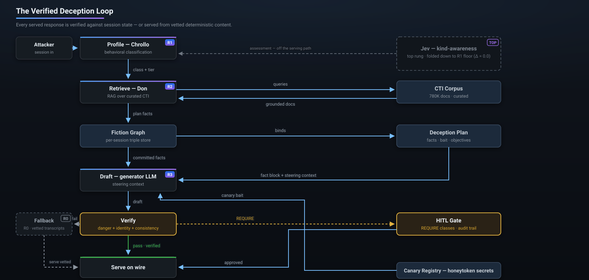

<div align="center">

# 🪜 The Intelligence Ladder

### Pricing AI Mechanisms in a Verified Deception Honeypot

*How much intelligence can a lie safely spend — and where must the spending stop?*

[](LICENSE)
[](https://www.python.org/)
[](llm-gateway/)
[](docker-compose.yml)
[](tests/)

**Canonical next release/submission surface: [`paper/sp2027.pdf`](paper/sp2027.pdf)** (shorter rescue manuscript, source [`paper/sp2027.tex`](paper/sp2027.tex)) · Full audit/extended companion: [`paper/main.pdf`](paper/main.pdf) ([`paper/main.tex`](paper/main.tex))

> Manuscript status (2026-10-08, Task 5 of the audit remediation plan):
> `paper/sp2027.tex` is the canonical surface for any future release/submission
> package; `paper/main.tex` is the full audit manuscript and is maintained as
> its companion. Neither PDF is submission-ready: the `algorithm.sty` blocker
> was resolved on 2026-10-08 by installing `texlive-science` (Task 7 of the
> audit remediation plan), and both PDFs were rebuilt from the current sources
> on 2026-10-08 (main.pdf 27 pp, sp2027.pdf 12 pp after hard-review integration). They become submission
> candidates only after the evidence gates in
> `docs/RAGIN_RESULTS_LEDGER_2026-10-08.md` pass.

</div>

---

## What this is

**RAGIN** is a medium-interaction deception honeypot whose every response is
either **verified against the session's deception state** or served from
**human-vetted deterministic content**. This repository contains the complete
system, the evaluation harness, and every persisted artifact behind the
numbers in the paper.

The paper asks one question: *deception systems keep adding intelligence —
templates, classifiers, retrieval, LLMs, adaptive agents — but what does each
rung actually buy, and what does it cost in trust?* The answer is organized as
a ladder, and the ladder runs in **both directions**: when a certifiable
mechanism reproduces an intelligent one's measured benefit, the intelligent
one is compiled down and removed.

## The ladder

Each rung is priced by its measured marginal effect over the rung beneath it.
The axis is **certifiability**: whether the mechanism's output can be checked
against a closed world before it reaches the wire.

| | Rung | Mechanism | Trust price | Measured effect |
|---|---|---|---|---|
| **R0** | Deterministic templates | The fallback — vetted transcripts | None | Consistency by construction; the control condition (ablation A5) |
| **R1** | Behavioral classification | **Chrollo** — RF classifier, offline, ms/decision | Auditable, deterministic | Held-out accuracy **0.8875 → 0.9550** with n-gram features |
| **R2** | Grounded planning | **Don** — RAG over 780K-doc curated CTI | Output is a statistic over an open corpus | Paired **+0.154** composite (95% CI [+0.092, +0.221]); **35 techniques detected vs 0** ungrounded |
| **R3** | Free generation | Provider LLM under the **serving-time verifier** | Uncertifiable in advance | Zero unverified serves · zero false-positive alerts (218-query live campaign) · **zero contradictions across 45 adversarial re-queries**, byte-identical determinism |
| **Top** | Adaptive kind-awareness | **Jev** — attack-kind assessment | Provider-dependent (and intermittently refused on attack-shaped inputs) | **12/13** real-log assessments corrected · bait exposure **+125%** · **no dwell gain** · **no routing effect the benchmark can resolve** (Δ = 0.0 at ceiling; hard-subset census: 6 informative sessions, 1 rescued live, 5 lost to provider refusals) — removed from the serving path |

The fold-down at the top rung is the result the paper is about: intelligence
past the point where a certifiable mechanism reproduces its effect — or where
the benchmark can resolve an effect at all — is not an asset; it is an attack
surface with a quota bill and an availability risk concentrated on the
highest-stakes sessions.

## Architecture

<div align="center">

</div>

The serving path runs top to bottom. Gates are amber; stores are grey; dashed paths are failure or assessment paths. Rung chips (R0–R3) mark where each ladder rung sits in the loop. Jev — the paper's top rung — is drawn as a **ghost node**: its routing benefit was compiled down to the deterministic floor (Δ = 0.0), so it does not sit on the serving path.

| Component | Language | Role |
|-----------|----------|------|
| **LLM Gateway** | Rust (Axum) | Multi-provider routing, auth, cost tracking, retries |
| **Chrollo** | Python | Behavioral classifier (R1) — routes each session to a deception policy |
| **Don** | Python | RAG threat-intelligence engine (R2) — CTI retrieval, ATT&CK mapping |
| **Hisoka** | Python | Deception layer — personas, honeytokens, fiction graph, verified-serve loop |
| **Jev** | Python | Kind-aware assessment (top rung) — priced, then folded down to a deterministic floor |
| **Redis / Prometheus / Grafana** | — | Session store, metrics, dashboards |

## Headline results (all artifact-backed)

| Claim | Number | Artifact |
|---|---|---|
| Grounding effect (paired, 90 sessions) | **+0.154** composite, CI [+0.092, +0.221] | [`results/b4_baseline_zodiac_20260922.json`](results/b4_baseline_zodiac_20260922.json) |
| Consistency under adversarial re-query | **0 contradictions / 45**, byte-identical replay | [`results/graph_consistency_bench.json`](results/graph_consistency_bench.json) |
| Live campaign (218 queries) | **0 unverified serves · 0 FP alerts** · 132 TTPs (67 unique) | [`results/live_benchmark_zodiac_20260922.json`](results/live_benchmark_zodiac_20260922.json) |
| Run-to-run stability | Δ **+0.005** composite · **0.991** per-row agreement — unchanged on the judge-audited rows | [`results/stability_run1_vs_run2.json`](results/stability_run1_vs_run2.json) (`audited_panel`) |
| Judge-panel audit | canary-bias magnitude **1.35** corrected · harness artifact reclassified · means 0.733→0.756 / 0.750→0.762 | [`results/live_benchmark_judge_panel_corrected.json`](results/live_benchmark_judge_panel_corrected.json) |
| Fold-down hard-subset census | **6/400** informative sessions (all APT, one rung under floor) · **1 rescued live**, 5 unavailable (provider refusals) | [`results/jev_hard_subset.json`](results/jev_hard_subset.json) |
| LLM-judge consensus (grok-4.7-free ×3 personas — not human raters) | **3.86/5**, agreement **0.750**, 8/8 scenarios above bar | [`results/human_eval_scored_20260922_180637_consensus/`](results/human_eval_scored_20260922_180637_consensus/) |
| Mechanism ablations A1–A5 | Each removal costs the property it was added to provide | [`results/ablation_battery.json`](results/ablation_battery.json) |
| Fold-down (kind-aware routing) | **Δ = 0.0** at the benchmark's resolution — LLM rung removed; claim resolution-bounded, not general subsumption | [`results/jev_ab_eval.json`](results/jev_ab_eval.json) + [`results/jev_hard_subset.json`](results/jev_hard_subset.json) |
| Next-TTP steering | top-1 **0.50** · top-3 **0.90** · MRR **0.67** | [`results/mtp_steering_eval.json`](results/mtp_steering_eval.json) |

## Quick start

```bash
git clone https://github.com/0xzodiac/The-Intelligence-Ladder.git
cd The-Intelligence-Ladder

python3 -m venv .venv && source .venv/bin/activate
pip install -e ".[test]"

cp .env.example .env        # add your LLM provider key

# Full stack (gateway, chrollo, don, hisoka, redis, nginx, monitoring)
docker compose up -d --build

# Or run the test suite offline
pytest -q
```

## Reproducing the paper

Every number in the paper resolves to a persisted artifact in [`results/`](results/).
**Environment:** Python 3.10+ venv with `pip install -e ".[test]"`; corpora live under
`data/` and `data/training/`; every command writes the listed artifact path. The
**provider-free** steps run offline (deterministic, 0 LLM tokens); only the **live**
steps call the LLM gateway and need a provider key in `.env`. Commands are marked
accordingly. Full protocol: [`paper/`](paper/) Appendix B. Short form:

```bash
# --- provider-free (offline, deterministic, no network) ---
pytest -q                                       # 1,715 collected = 1,599 passed + 116 skipped + 0 failed (2026-10-08)
python scripts/ablation_battery.py              # A1–A5 ablations → results/ablation_battery.json
python scripts/graph_consistency_bench.py       # C1 reward-free consistency → results/graph_consistency_bench.json
python scripts/mtp_steering_eval.py             # C3 next-TTP steering → results/mtp_steering_eval.json
python scripts/rescore_judge_panel.py           # judge audit → results/live_benchmark_judge_panel_corrected.json
python scripts/compare_run_stability.py         # run1-vs-run2 stability → results/stability_run1_vs_run2.json
# rescue benchmark: 400 held-out sessions (data/training/test.jsonl), 8 prefixes
python scripts/sp2027_rescue_behavior_benchmark.py  # → results/sp2027_rescue/behavior_trajectory_benchmark.json

# --- live (requires provider key in .env; calls the LLM gateway) ---
python scripts/run_live_benchmark.py            # 218-query campaign, run twice → results/live_benchmark_zodiac_20260922[_run2].json
python scripts/run_baseline_comparison.py       # paired RAG-vs-no-RAG (B4) → results/b4_baseline_zodiac_20260922.json
python scripts/score_human_eval.py              # 3 evaluator-prompt runs (single judge model) → results/human_eval_scored_*/; then scripts/build_consensus.py
```

The audit pipeline is self-maintaining: the twice-daily
`ragin-apmix-watch.timer` probe (catalog + quota) also reseeds the judge
audit and audited stability offline whenever a new campaign run lands —
no LLM calls, no manual bookkeeping. Exit semantics: `0` healthy,
`1` probe failure, `2` catalog drift, `3` reseeded but stability verdict
is `review` (surfaces in `journalctl --user -u ragin-apmix-watch.service`).

## Documentation

| Doc | Contents |
|---|---|
| [`docs/ARCHITECTURE.md`](docs/ARCHITECTURE.md) | System architecture and sequence diagrams |
| [`docs/OPERATIONAL_RUNBOOK.md`](docs/OPERATIONAL_RUNBOOK.md) | Day-to-day operations |
| [`docs/DEPLOYMENT_CHECKLIST.md`](docs/DEPLOYMENT_CHECKLIST.md) | Field deployment |
| [`docs/SECURITY_HARDENING.md`](docs/SECURITY_HARDENING.md) | Security posture |
| [`docs/COST_OPTIMIZATION.md`](docs/COST_OPTIMIZATION.md) | LLM cost tuning |
| [`docs/TROUBLESHOOTING.md`](docs/TROUBLESHOOTING.md) | Common issues |
| [`PROJECT_STATUS.md`](PROJECT_STATUS.md) | Phase-by-phase implementation status |

## Design guarantees

- **Consistency** — every host fact binds to one per-session fiction graph; the
  verifier rejects any draft that contradicts committed state (Property 1 in
  the paper, with proof).
- **Safety** — bait is drawn only from **canary-registered secrets**; nothing
  real is ever exposed, and any canary appearing in outbound traffic is
  attributable to bait interaction by construction.
- **Availability** — generation or verification failure falls back to vetted
  deterministic transcripts, never unverified improvisation.
- **Auditability** — every accept, reject, and HITL gate decision persists to
  an append-only log (2,108-record benchmark trail included).

## Security note

Historical pentest artifacts in this repository document a simulated attacker
recovering an early hard-coded gateway key. That credential was **rotated**,
and the historical record is redacted to `RAGIN_GATEWAY_KEY_ROTATED`. Runtime
secrets live in `.env` (never committed); see `.env.example`.

## License

Copyright © 2026 — [Apache License 2.0](LICENSE).

# agent-completion-marker-20261009T1000Z

# agent-completion-marker-non-destructive-append-20261009T1000Z-security-read

# agent-completion-marker-next-stage-generator-transport-20261009
