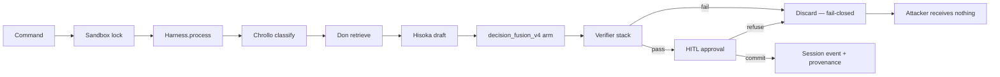
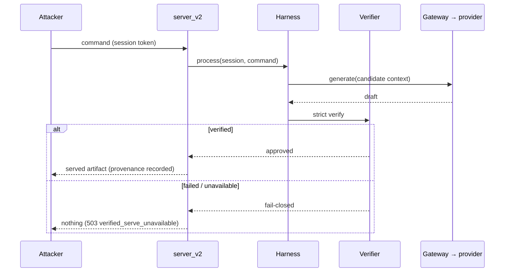
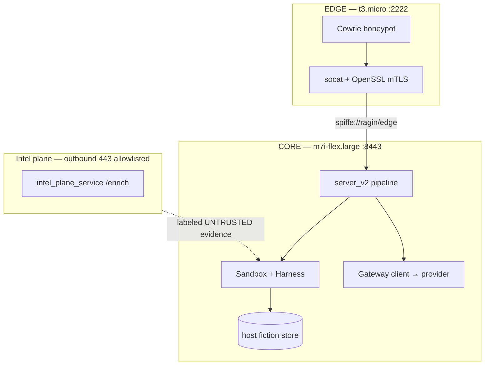

# RAGIN Architecture Documentation

**Updated:** 2026-10-24 — rewritten to match the actual runtime (v4 harness architecture).
The historical Phase 2.2 microservice design (separate Chrollo/Don/Hisoka HTTP services behind
nginx) is retained only as the legacy path in `ragin/server.py` and `docker-compose.yml`; it is
not the active serving architecture. Visual diagrams: `.archify/architecture-ragin-en-*/`.

---

## 1. System context

```
Attacker (SSH/Telnet)
   │
   ▼
Cowrie honeypot (EDGE, t3.micro, :2222)            [AWS eu-north-1]
   │  LLM backend: POST /v1/chat/completions
   ▼
socat + OpenSSL (mTLS client cert spiffe://ragin/edge)
   │
   ▼
RAGIN server_v2 (CORE, m7i-flex.large, :8443)      aiohttp · mTLS required · API-key auth
   │
   ├─► Sandbox (attacker-interaction isolation, command limits, honeytoken injection)
   │      └─► Harness.process(session, command)     [mandatory verification — always]
   │             ├─► Chrollo  (Random-Forest skill classifier)
   │             ├─► Don      (ThreatRAG: BM25/hybrid + command_aware_v2, MITRE, Evidence Judge)
   │             ├─► Hisoka   (adaptive deception: personas, response generation, dwell)
   │             ├─► decision_fusion_v4 (EvidenceQualityGate + PolicySelector — deterministic floor)
   │             ├─► Verifier stack (FictionConsistency → StrictResearch → Deadline → HostFiction)
   │             ├─► HITL ApprovalGateway (human only at REQUIRE; AUTO/NOTIFY programmatic)
   │             └─► Session (append-only JSONL event log · wake() resume)
   │
   └─► Host fiction store (pinned identity · verified artifacts only)
```

Nothing reaches the attacker unless the strict loop `_strict_verify → _strict_approval →
_strict_commit` commits it (`ragin/cycle/harness.py`). Every failure path returns fail-closed
(503 `verified_serve_unavailable`, empty `response_text`).

## 2. Components (real file paths)

| Component | Location | Role |
|---|---|---|
| HTTP server | `ragin/server_v2.py` | `/api/session/*` + cowrie LLM bridge `/v1/chat/completions`; mTLS + API key; session-token authorization |
| Orchestration | `ragin/cycle/harness.py` | stateless loop: classify → analyze → generate → verify → approve → commit; fallback template path re-verified identically |
| Session store | `ragin/cycle/session.py` | append-only JSONL per session; crash-safe resume via `wake()` |
| Sandbox | `ragin/cycle/sandbox.py` | per-session locks (sharded), command limits, artifact injection, final verification barrier |
| Adapters | `ragin/cycle/adapters.py` | protocol bridges over Chrollo/Don/Hisoka + optional Laya mappers |
| Coordination | `ragin/cycle/coordination.py` | Supervisor / VotingSystem / ExpertPool / DelegationChain patterns |
| Verifier | `ragin/cycle/verifier.py` (+ `strict_research.py`, `verification_deadline.py`) | fiction-consistency, danger signals, deterministic=True |
| HITL | `ragin/cycle/hitl.py` | ApprovalGateway; human decision only at REQUIRE level; audited fail-closed without approver |
| Classifier | `ragin/chrollo/` | Random-Forest skill level (novice→apt) |
| ThreatRAG | `ragin/don/` | hybrid BM25/RRF retrieval, `command_aware_v2` deterministic retriever, MITRE mapping, LightRAG adapter, `evidence_judge.py` (EVIDENCE_JUDGE_V1) |
| Deception | `ragin/hisoka/` | personas, response generation, real-shape secret battery (`_contains_danger_signal`), session manager (Redis optional), dwell/memory |
| Decision floor | `ragin/decision_fusion_v4/` | EvidenceQualityGate + Baseline/Deterministic/Logistic selectors; the authoritative decision path |
| JEV (optional) | `ragin/jev/` + `ragin/gateway/client.py` | typed-questions Decisions API (beatapi `jev-1.14-free`); additive signal, default OFF in serving |
| Laya (frozen) | `ragin/decision/` | local Router inference; **OFF by default** — v12 verdict `TUNING_FAIL_REDESIGN_REQUIRED` (kept as research evidence) |
| LLM transport (Gateway) | `ragin/gateway/client.py` → provider | shared client (generation contract, retries, observation ledger); transport style via `RAGIN_LLM_API_STYLE` (`chat` default = `/v1/chat/completions`, `responses` = `/v1/responses` for providers that only route their current models there) + optional `RAGIN_LLM_USER_AGENT`; Rust `llm-gateway/` exists but is not the active path |
| Intelligence | `ragin/don/intel_mcp.py` + `scripts/intel_plane_service.py` | intel plane: live CVE/EPSS/KEV enrichment for Don's retrieval pool behind `/enrich`, running where outbound 443 to NVD/EPSS/KEV is allowlisted; every hit enters the pool as labeled UNTRUSTED evidence (study: `docs/INTEGRATION_STUDY_CVE_MCP.md`) |
| Capture | `ragin/capture_v4/` | cowrie log ingestion: lineage, manifest sealing, privacy minimization (`bounded_redacted_text` shared with serving) |
| Containment | `ragin/cycle/containment/` | WS3: egress guard, metadata isolation, HMAC audit chain + restart persistence |
| Observability | `ragin/monitoring/` | metrics/alerts/audit (unwired SIEM/rollout scaffolding deleted 2026-10-26 — see §6) |
| Benchmark/eval | `ragin/benchmark/`, `ragin/evaluation/`, `scripts/` | harness_bridge closed-loop eval, attacker policies, ablation battery, LAYA/JEV study drivers |

## 3. Verified-serving flow (the core loop)



1. Command arrives (session API or cowrie bridge) → session token checked → sandbox lock.
2. Harness builds context from Session events; Chrollo classifies; Don retrieves (bounded
   scores, provenance-stamped backend); Hisoka drafts a deception candidate.
3. `decision_fusion_v4` computes the decision arm; optional JEV/Laya signals attach as
   bounded, non-authoritative annotations.
4. Verifier stack checks the candidate against the fiction graph + danger signals (real-shape
   secret battery over an NFKC/zero-width-hardened view).
5. HITL approves (programmatic at AUTO/NOTIFY; human at REQUIRE; fail-closed without approver).
6. Commit writes the event; the served artifact is recorded with `serve_path` provenance
   (`GENERATED_VERIFIED / FASTPATH / FALLBACK / RETRY / UNVERIFIED`).
7. Any failure: candidate discarded, attacker receives nothing (fail-closed).



## 4. Deployment reality (AWS eu-north-1, verified 2026-10-24)



- **EDGE** (`i-05bc6aab0bd4260a7`, t3.micro, REDACTED_FLEET_HOST): Cowrie + socat mTLS chain.
- **CORE** (`i-062a400b300f4f9e4`, m7i-flex.large, REDACTED_FLEET_HOST): `python3 -m ragin.server_v2
  --mode pipeline` on `:8443`, mTLS required, provider currently blackholed.
- Status: both running since Oct 9; **zero attacker data collected** (port 2222 never exposed,
  certs expired Oct 11 — revival checklist in `docs/MASTER_PLAN_2026-10-24.md` Phase 1).
- Storage: host fiction `/app/data/host_fiction.json`; field export `RAGIN_FIELD_EXPORT_DIR`;
  sessions append-only JSONL.

## 5. Configuration surface (env-first)

| Var | Meaning |
|---|---|
| `RAGIN_LLM_BASE_URL` / `RAGIN_LLM_API_KEY` / `RAGIN_LLM_MODEL` | LLM provider (agentrouter.org since 2026-10-27, replacing apmix free tier; key in gitignored `.env`) |
| `RAGIN_LLM_API_STYLE` / `RAGIN_LLM_USER_AGENT` | Transport style (`chat`/`responses`) and optional User-Agent override (both default unset = unchanged legacy behavior) |
| `RAGIN_JEVI_BASE_URL` / `RAGIN_JEVI_API_KEY` / `RAGIN_JEVI_MODEL` / `RAGIN_JEVI_ENABLED` | JEV Decisions API (beatapi) |
| `RAGIN_LAYA_ENABLED` | Laya decision opt-in (default 0; never default-on) |
| `RAGIN_MTLS_REQUIRED` + `RAGIN_MTLS_{CERT,KEY,CA}_FILE` + `RAGIN_MTLS_ALLOWED_IDENTITIES` | mTLS (validated unconditionally at app creation) |
| `RAGIN_REQUIRE_AUTH`, `API_KEY` | API-key middleware (placeholder keys refuse boot) |
| `RAGIN_DON_RETRIEVAL_VERSION` / `RAGIN_RAG_MODE` | retrieval backend selection (`command_aware_v2` active in hybrid and bm25 modes) |
| `RAGIN_MAX_REQUEST_BYTES`, `RAGIN_BIND_HOST`, `PORT` | serving limits |

## 6. API contracts

| Route | Served by | Contract |
|---|---|---|
| `POST /api/classify` | `ragin/server.py` (Chrollo, legacy path behind nginx) | `X-API-Key`; skill-level classification |
| `POST /api/analyze` | `ragin/server.py` (Don, legacy path) | `X-API-Key`; threat analysis |
| `POST /api/deceive` | `ragin/server.py` (Hisoka, legacy path) | `X-API-Key`; deception — routed to the `legacy_serve` guard, response generation itself runs in the harness loop |
| `POST /api/assess` | `ragin/server.py` (JEV, legacy path) | `X-API-Key`; typed-questions assessment |
| `GET /health`, `GET /ready`, `GET /metrics` | both servers | liveness / readiness / Prometheus |
| `POST /api/session/create\|command\|wake\|replay`, `GET /api/session/{id}/context` | `ragin/server_v2.py` (active path) | session-token authorization + API key |
| `POST /v1/chat/completions` | `ragin/server_v2.py` (active path) | cowrie LLM bridge, mTLS required |
| `POST /enrich` | `scripts/intel_plane_service.py` (intel plane) | bounded, cached, fail-graceful CVE evidence |

The nginx maps (`ragin/config/nginx*.conf`) front the legacy routes; the active
serving path is `server_v2` and does not depend on them.

## 7. Legacy surface (kept, clearly marked)

- `ragin/server.py` — Phase 2.2 microservice entry (Chrollo/Don/Hisoka on 8081–8083 behind
  nginx). Present but not the active path; do not extend.
- `docker-compose.yml` — the old compose topology; a v4 compose profile is pending
  (see `docs/MASTER_PLAN_2026-10-24.md` Phase 4).
- `ragin/siem/`, `ragin/rollout/`, `ragin/auth/` — **deleted 2026-10-26** (decision on this
  plan line): verified zero live callers first (nginx `/rollout/status` is a static
  `return 200`; `server_v2` auth is its own API-key middleware; monitoring never imported
  the SIEM connectors), then removed with their unit tests and `ragin/config/rollout/`
  stage files. Reintroduce only together with a live caller on the serving path.
