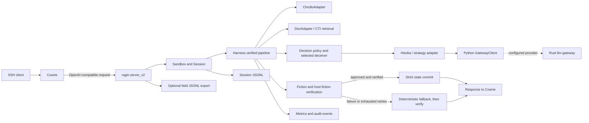
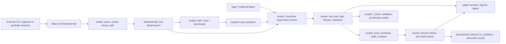

# RAGIN System Architecture and Evidence Lineage

**Purpose.** This is a source-grounded map of the repository as inspected on 2026-10-14. It connects runtime modules, data and configuration, evaluation scripts, persisted results, and manuscript outputs. It describes the checked-out worktree, which contains substantial pre-existing tracked and untracked changes; it is not a clean-commit release specification. No code or result files were changed to create this document.

**Detailed index.** See [the source-to-result file lineage index](SYSTEM_FILE_LINEAGE_INDEX.md) for the complete Python/Rust source inventory and line-numbered literal result-path references found in the experiment runners and manuscript sources.

**Repository boundary.** The project Git root is `RAGIN-Retrieval-Augmented-Honeypot-Intelligence/`. Its parent `/home/elaref/Documents/research/ragin/` is a workspace wrapper, not a monorepo. On the 2026-10-14 inventory pass, excluding Git metadata, virtual environments, caches, and Rust `target/`, the wrapper contained 12,579 files and the nested checkout contained 12,040. The wrapper has its own `../docs/next_stage/`, `../docs/remediation_execution/`, `../paper/`, `../ragin/`, `../scripts/`, `../graphify-out/`, and `../CLAUDE.md`; these are not checkout files. The code and results maps below target the nested repository, with workspace-only materials explicitly identified.

## Repository map

| Top-level path | Contents and role |
|---|---|
| `ragin/` | Python runtime, data/model types, capture, policy, benchmark, and integrations. |
| `llm-gateway/` | Rust gateway source/configuration plus a present `target/` build tree; Cargo build products are not source. |
| `scripts/`, `run/`, `tools/` | Experiment/data utilities, operational launch/run artifacts, and helper tooling. |
| `data/`, `models/` | Inputs/corpora/session records and trained model artifacts. |
| `results/`, `evidence/`, `logs/` | Research outputs, evidence packets, and operational logs; populations have different provenance and status. |
| `tests/` | Unit, integration, security, and artifact/benchmark checks. |
| `paper/`, `algorithms/`, `dist/` | Manuscript sources/build outputs, algorithm writeups/build outputs, and exported distribution/package artifacts. |
| `docs/`, `human_delivery/`, `human_handoff/`, `human_returns/` | Project/audit/protocol documentation and separate annotation packet, handoff, and return materials. |
| `docker-compose*.yml`, `Dockerfile*`, `.github/`, `pyproject.toml`, `Cargo.toml` | Deployment wiring, CI, and language/tool configuration. |
| `graphify-out/` | Derived code knowledge graph and reports used for navigation; may lag working-tree edits. |

### Workspace wrapper files outside Git

| Workspace path | Relationship and boundary |
|---|---|
| `../docs/next_stage/` | RAGIN execution tracker, architecture, regression, generator transport, Laya, and SSH-wire evidence. These are operational records outside the project Git root; their claims need source/live-evidence checks before being treated as current. The tracker records SSH-wire E2E as blocked in its host snapshot. |
| `../docs/remediation_execution/` | Separate remediation status and local evidence JSON. Not a source package and not included in the nested checkout's tracked history. |
| `../paper/main.tex` and `../paper/tdsc/` | Separate RAGIN TDSC manuscript snapshot and supporting figures/build products. The title/scope differ from the nested checkout's `paper/main.tex` and `paper/sp2027.tex`; no automatic source/result identity link exists between these manuscript trees. |
| `../ragin/cycle/containment/` | Workspace copy of five Python paths also present under nested `ragin/cycle/containment/`. On this snapshot `metadata_isolation.py` and `restart_persistence.py` are byte-identical, `__init__.py` and `container_egress.py` differ in small text changes, and `audit_integrity.py` has 127 lines here but is empty in the checkout. Do not import or cite the outer copy as implementation in the nested Git project. |
| `../scripts/_tmp_launcher4.py`, `../scripts/_tmp_run_completion.sh` | Workspace-level temporary launch artifacts, not nested project scripts. They reference and launch the nested checkout. |
| `../graphify-out/` | A second graph index for the wrapper. Separate from `graphify-out/` in the nested checkout; neither is a source-of-truth artifact. |
| `../CLAUDE.md`, `../.claude/` | Workspace-level navigation and agent instructions. These influence tool use but are not project runtime code. |

## Static code relationship audit

The source inventory excluded `.git`, virtual environments, bytecode/cache trees, and Rust `target/` build output. It found 368 Python source files in the checkout and parsed all 368 with Python's AST without a syntax-parse error. A static import scan found 816 imports whose module begins with `ragin`, across 197 source files. Import edges are concentrated in `ragin.cycle`, `ragin.hisoka`, `ragin.chrollo`, `ragin.don`, and `ragin.benchmark`; tests and scripts account for a large share of callers. This is a source-level dependency map, not proof that each optional module is imported or exercised at runtime.

The 134 top-level `scripts/*.py` runners contain 293 distinct line-level `results/` string literals across 87 files in the refreshed AST scan. These literals establish useful producer/consumer clues, but paths constructed dynamically, shell runners, and values generated through config/CLI are not fully captured by string scanning. The companion [file lineage index](SYSTEM_FILE_LINEAGE_INDEX.md) lists every captured literal and line; use the script body and that experiment's freeze/manifest to complete result-specific provenance.

## Architecture at a glance

This is the intended active field/pipeline path reflected by the current source wiring. It is distinct from component-level APIs, offline benchmarks, and the Rust gateway's standalone HTTP service.

## Runtime entry points and request path

| Entry point | Source/configuration | Role and boundary |
|---|---|---|
| Pipeline HTTP server | `ragin/server_v2.py`; field Compose and `scripts/` launchers | Cowrie bridge plus session APIs. `_init_pipeline()` builds Chrollo, Don, the selected deceiver, `Harness(mandatory_verification=True, host_store=..., host_fiction_path=...)`, and `Sandbox`. |
| Legacy/component server | `ragin/server.py`; `Dockerfile.python`, main Compose | Health and separate classifier/analyzer/assessment component endpoints. The legacy Hisoka serving routes are disabled with HTTP 410; do not infer the field request path from the default container entrypoint alone. |
| Rust LLM gateway | `llm-gateway/src/main.rs`, `llm-gateway/Cargo.toml`, `llm-gateway/config.toml` | Separate Axum HTTP API for provider generation, model catalog, cost estimation, health, and metrics. Python reaches a gateway through `ragin/gateway/client.py`; gateway availability/provider configuration is an external runtime dependency. |
| Offline/research runners | `scripts/*.py`, `ragin/benchmark/`, `ragin/decision_fusion_v4/` | Training, frozen execution, scoring, audit, and benchmark paths. These are not automatically part of serving merely because the code is in the same package. |

### Verified request lifecycle

1. Cowrie sends a chat-completions-shaped request to `server_v2.openai_chat_completions`; the bridge extracts the attacker command and resolves a session identifier.
2. `Sandbox.handle_command()` creates or resumes a `Session`; `ragin/cycle/session.py` records append-only session events and reconstructs context.
3. `Harness.process()` dispatches to `_process_verified()` because `mandatory_verification` is true in current `server_v2._init_pipeline()`.
4. The harness classifies with `ChrolloAdapter`; when enabled, the adapter may attach an optional Laya assessment as advisory classification metadata. It enriches context with `DonAdapter`, selects the decision arm/deceiver, then obtains a candidate response through the configured Hisoka/strategy/provider path. The Laya signal does not bypass the verifier or create a separate serving endpoint.
5. The harness verifies a candidate against fiction state and host-fiction constraints, applies approval policy, and commits accepted state through its strict commit path before returning a served response. Failed candidates are retried within the configured bound; the deterministic response path is itself verified. If no verified response can be committed, the handler returns an error rather than an unverified candidate.
6. Session events are persisted through `Session`; optional field export in `server_v2` is best-effort. Metrics, audit, and field exports are distinct sinks and should not be treated as one atomic evidence record.

The LangGraph orchestration in `ragin/cycle/graph.py` is a separate implementation path. The active field pipeline described above uses `Harness`/`Sandbox`; the existence of graph nodes does not mean the graph is serving Cowrie traffic.

## Codebase modules and their relationships

| Area | Main files | Inputs and outputs / relationship |
|---|---|---|
| Classification (Chrollo) | `ragin/chrollo/{session_parser,features,features_seq,models,classifier,pipeline}.py` | Session commands become feature vectors and skill predictions. The runtime adapter consumes classifier output; training/evaluation scripts consume session corpora and write model artifacts under `models/chrollo/`. |
| Threat intelligence (Don) | `ragin/don/{rag_engine,vector_store,intel_corpus,cti_corpus,command_aware_v2,threat_mapper,models,pipeline}.py` | Query and session context flow through sparse/dense retrieval and ATT&CK mapping into structured analysis for the harness and evaluator. Corpus builders/freezers under `scripts/` create versioned inputs in `data/corpus/`, `data/external/`, or frozen experiment directories. |
| Deception (Hisoka) | `ragin/hisoka/{deceiver,deception,response_generator,persona,honeytokens,fs_ledger,dwell_tracker,memory,session_manager,models,pipeline}.py` | Context and strategy become a draft, persona/artifact metadata, and serve-path metadata. `ResponseGenerator` uses the Python gateway client when a provider draft is configured; deterministic responses are a separate fallback path. |
| Orchestration and session state | `ragin/cycle/{harness,sandbox,session,adapters,provider_transport,coordination,hitl,verifier,supported_claims,metrics}.py` | Connects the three components, manages session events, retries, verification, approvals, response commit, and observation. `ragin/cycle/graph.py` supplies an alternate graph-based orchestration. |
| Fiction and host state | `ragin/graph/{fiction,host_fiction,mitre}.py` | Fiction graph maintains per-session consistency; host-fiction store/verifier adds host-level identity and consistency constraints. Persistence behavior depends on configured path and the active call path. |
| Decision/policy research | `ragin/decision/`, `ragin/decision_fusion_v4/` | Optional Laya runtime and policy/benchmark/evidence-export variants. These experiments have their own frozen inputs, policy contracts, and output trees; do not equate their output with Chrollo ground truth or a paper result without matching protocol lineage. |
| Jev assessment | `ragin/jev/{client,models,assessment,orchestration}.py` | Optional kind-aware attack assessment and routing research; not a default serving rung in the current field pipeline. Its result families live in `results/` and supporting `docs/jev*`/`docs/laya_integration/` records. |
| Gateway and transport | `ragin/gateway/client.py`, `ragin/transport/mtls.py`, `llm-gateway/src/` | Python clients and transport adapters call configured provider endpoints; Rust gateway implements a separate HTTP/provider layer. A configured endpoint or code path is not evidence of an available provider or deployed network control. |
| Observability and integrations | `ragin/monitoring/`, `ragin/auth/`, `ragin/siem/`, `ragin/rollout/`, `ragin/decoys/` | Health, audit, metrics, auth, SIEM export, rollout, and service decoy support. Runtime activation is determined by entrypoint and deployment configuration, not package presence. |
| Data capture and lineage | `ragin/capture_v4/` | Cowrie capture, canonical-record lineage, privacy, registry, and manifest logic for prospective/frozen data. Its artifacts are distinct from synthetic training records and historical session logs. |

### Python package file inventory

The file lists below enumerate substantive modules in the checked-out `ragin/` package, including the untracked containment directory present in this worktree. Each listed package also has an `__init__.py` (the root package has one too). These files provide package exports; they do not imply automatic registration or runtime activation.

| Package | Files and responsibility boundary |
|---|---|
| `ragin/` | `server.py`, `server_v2.py`, `utils.py`; legacy component server, pipeline/server-v2 ingress, shared helpers. |
| `ragin/auth/` | `rbac.py`; role and access policy. |
| `ragin/benchmark/` | `core.py`, `cowrie_adapter.py`, `effectiveness.py`, `harness_bridge.py`, `honeygpt_benchmark.py`, `human_eval.py`, `human_eval_personas.py`, `run_benchmarks.py`; benchmark contracts, adapters, scoring, evaluator, and runners. |
| `ragin/capture_v4/` | `cowrie.py`, `lineage.py`, `manifest.py`, `privacy.py`, `registry.py`; capture parsing, canonical lineage/digests, manifests, privacy, and registry. |
| `ragin/chrollo/` | `classifier.py`, `features.py`, `features_seq.py`, `models.py`, `pipeline.py`, `session_parser.py`; classifier and its inputs/features. |
| `ragin/cycle/` | `adapters.py`, `coordination.py`, `graph.py`, `harness.py`, `hitl.py`, `metrics.py`, `multi_turn.py`, `provider_transport.py`, `sandbox.py`, `session.py`, `supported_claims.py`, `threat_modeling.py`, `verifier.py`; orchestration, session lifecycle, candidate generation, review, verifier, and telemetry. |
| `ragin/cycle/containment/` | `audit_integrity.py`, `container_egress.py`, `metadata_isolation.py`, `restart_persistence.py`; currently untracked; see the incomplete-import finding below. |
| `ragin/decision/` | `laya_decision.py`, `laya_runtime.py`, `optional.py`; optional assessment contracts/runtime. |
| `ragin/decision_fusion_v4/` | `benchmark.py`, `config.py`, `evidence_export.py`, `matched_runner.py`, `policy.py`, `policy_v2.py`, `runtime_mode.py`; separate policy and matched-evaluation research subsystem. |
| `ragin/decoys/` | `base.py`, `http_service.py`, `manager.py`, `ssh_service.py`, `telnet_service.py`; decoy-service abstractions and protocol handlers. |
| `ragin/don/` | `attack_heatmap.py`, `command_aware_v2.py`, `cti_corpus.py`, `cti_feeds.py`, `evidence_judge.py`, `extended_cti_loader.py`, `graph.py`, `intel_corpus.py`, `lightrag_adapter.py`, `mitre_cti_loader.py`, `models.py`, `pipeline.py`, `rag_engine.py`, `threat_mapper.py`, `vector_store.py`; corpus/retrieval, CTI feeds, mapping, analysis, and evidence judging. |
| `ragin/gateway/` | `client.py`; Python-side gateway/provider HTTP client. |
| `ragin/graph/` | `fiction.py`, `host_fiction.py`, `mitre.py`; session/host fiction state and ATT&CK graph logic. |
| `ragin/hisoka/` | `deceiver.py`, `deception.py`, `dwell_tracker.py`, `fs_ledger.py`, `honeytokens.py`, `memory.py`, `models.py`, `persona.py`, `pipeline.py`, `response_generator.py`, `session_manager.py`, `strategy_generator_v1.py`; deception generation, state, artifacts, and engagement. |
| `ragin/intelligence/` | `adaptive_response.py`, `evasion_detector.py`, `models.py`, `skill_strategy.py`; evasion and strategy support. |
| `ragin/jev/` | `assessment.py`, `client.py`, `models.py`, `orchestration.py`; optional Jev assessment integration. |
| `ragin/monitoring/` | `alerts.py`, `audit.py`, `health.py`, `metrics.py`; application monitoring and audit helpers. |
| `ragin/rollout/` | `manager.py`, `metrics.py`, `models.py`; staged rollout controls and telemetry. |
| `ragin/siem/` | `connector.py`, `elasticsearch.py`, `splunk.py`, `syslog.py`; SIEM event export adapters. |
| `ragin/transport/` | `mtls.py`; TLS/mTLS transport helpers. |

### Other executable source inventories

- `llm-gateway/src/`: `main.rs` starts the Axum server; `lib.rs` exposes the library; `gateway.rs` implements routing/provider operations; `clients.rs` holds upstream clients; `config.rs` and `models.rs` define configuration and request/response types; `prompt_engine.rs` handles prompt construction; `validation.rs` validates inputs; `error.rs` maps errors; `metrics.rs` serves gateway telemetry. `Cargo.toml`/`Cargo.lock` govern this Rust build separately from Python packaging.
- `scripts/`: 134 top-level Python files plus shell and config/helper files. They fall into data/train (`generate_training_data`, `retrain_chrollo*`, `build_don_v2_corpus`, `freeze_don_v2`), runtime/deploy (`field_*`, `deploy*`, `provision*`, `opencode_proxy`), benchmark/evaluation (`run_*benchmark*`, `jev_*`, `laya_*`, `v4_*`), derivation/audit (`bootstrap_ci`, `rescore_*`, `two_channel_metrics`, `verifier_*`, `audit_*`), and paper generation (`gen_sp_figures`, `gen_two_channel_tables`, `render_validation_section`). The exact output references and experiment contract are in each script and the corresponding frozen result manifest.
- `tests/`: 97 Python test files, primarily in `tests/unit/`, `tests/integration/`, and `tests/security/`; names pair with the module/contract under test. The tests exercise adapters, classification, Don retrieval, fiction/verifier, harness/server paths, Laya, V4, artifact contracts, timing, and security. `pyproject.toml` sets test discovery and markers.
- Additional source: `services/mock_provider.py` is a test/provider stub; `tools/ingest_expert_ai_panel.py` ingests an expert AI panel; `dist/ragin-sp-mirror/scripts/` contains nine copied scripts within an anonymized distribution snapshot. `dist/` is an exported bundle with selected paper/results/scripts plus manifests and a tar archive, not the canonical source tree; compare its manifest to the release freeze before citing it.

## Inputs, artifacts, and results lineage

| Repository area | Role in lineage | Interpretation rule |
|---|---|---|
| `data/sessions/` | Session records; includes synthetic, historical, and possible capture-derived populations. | Determine source and admissibility from each experiment's manifest/provenance; directory membership alone does not identify real attacker data. |
| `data/training/`, `data/corpus/`, `data/external/`, `data/prospective_v4/` | Model training, retrieval corpora, third-party source snapshots, and prospective capture/evaluation pools. | Treat split, source revision, license/provenance, and freeze artifacts as part of the input identity. |
| `models/` | Serialized classifiers and associated training/tuning manifests. | Model files are generated outputs; tie each evaluation to the exact file hash and manifest when asserting reproducibility. |
| `results/` | On this snapshot: 2,435 files (1,466 JSON, 919 JSONL, 23 Markdown, 12 CSV, 8 logs, 2 text, 2 joblib, 2 PNG, 1 TeX); 165 are directly under `results/`, with the rest grouped in experiment trees. All 1,466 JSON documents parsed successfully. Of 919 `.jsonl` files, 918 contain parseable JSON records line-by-line (17,036 nonblank records total); the remaining `results/laya_research/real_inference_cpu_pilot.jsonl` is a single pretty-printed JSON object spread over 2,416 nonblank lines. | It is not a single homogeneous results table. Preserve failed, exploratory, provider-blocked, AI-derived, human-labeled, and canonical populations separately. Read each experiment's manifest and ledger before interpreting values. The CPU pilot's extension is misleading; its producer/consumer use whole-document JSON and the raw file is left untouched. |
| `scripts/` | Producers, transformations, validators, and paper-generation utilities. | A script name is not sufficient lineage. Record its inputs, arguments, frozen contract, execution mode, and output artifacts. |
| `paper/` | `main.tex` full audit manuscript and `sp2027.tex` shorter S&P surface; shared sections, figures, tables, and `references.tex`; compiled PDFs are generated outputs. | `sections/sp_appendix.tex` names several source result artifacts. Paper text and generated PDFs are downstream claims, not the source of truth for underlying measurements. |
| `docs/RAGIN_RESULTS_LEDGER_2026-10-08.md`, `docs/RAGIN_RELEASE_MANIFEST_2026-10-08.md`, `docs/SP2027_AUDIT_2026-10-03.md` | Claim-to-artifact map, release provenance, and an earlier structural results audit. | These are dated snapshots. Their counts, hashes, and release status must not be silently treated as current on 2026-10-14. |

### Key experiment families and producing code

| Family | Representative producer/deriver | Primary artifact locations |
|---|---|---|
| Main ladder, live campaign, paired grounding, stability | `scripts/run_live_benchmark.py`, `scripts/run_baseline_comparison.py`, `scripts/bootstrap_ci.py`, `scripts/compare_run_stability.py`, `scripts/rescore_judge_panel.py` | Root `results/*.json`, `results/bootstrap_ci.json`, related per-run rows and audit files |
| Fiction consistency, verifier batteries, served-text analysis | `scripts/graph_consistency_bench.py`, `scripts/verifier_redteam*.py`, `scripts/two_channel_metrics.py`, `scripts/gen_two_channel_tables.py` | `results/` verifier, graph, red-team, cross-family, and channel artifacts; manuscript tables/figures under `paper/` |
| Chrollo training and behavior trajectory | `scripts/generate_training_data.py`, `scripts/train`/`retrain_chrollo*.py`, `scripts/learning_curve_chrollo.py`, `scripts/sp2027_rescue_behavior_benchmark.py` | `data/training/`, `models/chrollo/`, `results/sp2027_rescue/` |
| Don retrieval and CTI evaluation | `scripts/build_don_v2_corpus.py`, `scripts/freeze_don_v2.py`, `scripts/run_don_v2_substantive_final_v1.py`, `scripts/cti_manual_audit.py` | `data/corpus/`, frozen corpus metadata, `results/` Don/evidence-judge/CTI families |
| Jev and Laya decision studies | `scripts/jev_*`, `scripts/laya_*`, `scripts/primary_169_*`, `scripts/locked_ai_reference_evaluation_v1.py` | `results/laya_decision_v2/`, `results/laya_decision_v3/`, `results/laya_research/`, `results/decision_fusion_v4/`; protocol and interpretation docs in `docs/laya_integration/` and `docs/decision_fusion/` |
| Prospective V4 capture and policy evaluation | `ragin/capture_v4/`, `ragin/decision_fusion_v4/`, `scripts/v4_*`, `scripts/run_hf2024_*` | `data/prospective_v4/`, `results/decision_fusion_v4/`, `docs/decision_fusion/` |
| Deployment and operational evidence | `docker-compose*.yml`, `Dockerfile*`, `scripts/field_*`, `scripts/deploy*`, `scripts/provision*` | Nested-checkout records under `docs/task*`, `docs/72h_sprint/`, `docs/aws_live_recovery/`, plus `evidence/` and `results/ssh_wire/`; wrapper-level next-stage records are at `../docs/next_stage/` and are outside Git. |

### Results directory populations observed

| Results subtree | Files on inventory pass | What it contains / key distinction |
|---|---:|---|
| `results/` root | 165 | Main ladder, verifier, campaign, bootstrap, and paper-support artifacts, including current and historical variants. |
| `results/laya_decision_v2/` | 1,843 | Dominant study archive: freezes/manifests, raw decision event streams, paired arms, runtime session outputs, exploratory 120-case and primary 169-case work. Keep exploratory, raw execution, reference, and locked analysis phases separate. The files are not interchangeable independent observations. |
| `results/laya_research/` | 204 | Candidate/annotation packets, AI rater workspaces and derived audits, real-model pilot, reference and matched-ablation outputs. AI-derived labels are not human ground truth; the CPU pilot's `.jsonl` is one formatted JSON document. |
| `results/decision_fusion_v4/` | 125 | V4 policy, capture, holdout, raw arm records, integration, and synthetic/retrospective evaluation artifacts. Frozen protocols, attempts, raw outputs, and derived analyses are different stages. |
| `results/evidence_judge*` | 30 | Contract, filtering, paired-validation, and real-data ablation/final paired audit packages; includes protocol and limitation reports. |
| `results/human_eval*` and `results/human_blind/` | 37 | Multiple scoring runs, packets, responses, and consensus/derived forms; run and rater identity must be retained. |
| `results/sp2027_rescue/` | 7 | Held-out behavior trajectory benchmark and supporting report. |
| `results/laya_decision_v3/`, `results/model_quality/`, `results/stat_eval/`, `results/ssh_wire/` | 7, 7, 3, 0 | V3 evaluation, model diagnostics, statistical artifacts, and an empty SSH-wire result directory on this inventory pass. An empty path is not live-wire evidence. |

Counts describe the inspected checkout at inventory time and may change as experiments write outputs. The CPU pilot has a direct producer/consumer link: `scripts/laya_real_inference_pilot.py` writes the single JSON object; `scripts/laya_ablation_analysis.py` loads it using `json.loads(SRC.read_text())` and writes `matched_ablation_analysis.json`. The extension/format mismatch is confirmed by source and parser behavior, not inferred only from the filename.

Other concrete producer/consumer examples: `scripts/run_baseline_comparison.py` produces paired RAG/no-RAG campaign rows, while `scripts/bootstrap_ci.py` derives intervals from specified artifacts; `scripts/compare_run_stability.py` consumes the two explicitly named zodiac campaign artifacts and writes `stability_run1_vs_run2.json`; `scripts/verifier_redteam.py` plus `scripts/verifier_redteam_cases.py` produce deterministic verifier evidence checked by `scripts/verifier_redteam_check.py` and CI-manifest scripts; `scripts/laya_primary_169_blind_execution_v2a.py` and later `primary_169_*` scripts separate raw execution, reference, and locked analysis under `results/laya_decision_v2/`; `scripts/run_hf2024_*` use frozen selection/protocol artifacts and emit raw arm results under `results/decision_fusion_v4/`; and `scripts/build_anonymized_mirror.py` copies a selected paper/results/script subset into `dist/ragin-sp-mirror/` with redaction and manifests. These chains are not interchangeable: exact version, hashes, inputs, explicit CLI arguments, and status are defined by their own manifests.

These are navigation pointers, not an assertion that every artifact family was recomputed or validated during this architecture audit. Specific result values remain governed by their frozen manifests and the dated results ledger.

## Tests and validation map

- `tests/unit/` exercises module behavior; `tests/integration/` exercises composed paths and readiness; `tests/security/` covers security-specific assertions; additional benchmark/contract tests sit in the remaining `tests/` paths.
- `pyproject.toml` configures pytest discovery under `tests/`, async mode, markers, coverage source, Ruff, and mypy settings.
- Result integrity tools such as `scripts/verifier_redteam_check.py`, `scripts/validate_release_artifacts.py`, `scripts/audit_figure_geometry.py`, and provenance/manifest checkers validate specific artifact contracts; they do not establish deployment behavior or validate every result directory.
- This documentation task did not run tests, benchmarks, external provider calls, infrastructure checks, or manuscript builds.

### Audit coverage and limits

- Workspace and checkout directory/file inventories were enumerated with generated/build/cache directories excluded as stated above. The full source-level import inventory covered 368 Python files and found no AST parse errors.
- All 1,466 JSON files under `results/` were parsed as whole JSON documents. JSONL line-format validation covered the 919 `.jsonl` paths; 918 parsed line-by-line and one was separately parsed as a whole JSON document. The malformed line count for that one suffix-mismatched file is formatting, not 2,416 independent corrupt rows.
- I inspected the active server/harness wiring, the major package modules, experiment scripts and consumers, existing architecture/audit notes, the results ledger, and paper entrypoints. I did not recompute experimental statistics, validate every result's scientific admissibility, read every raw session/corpus/model binary/log/PDF, run the full test suite, or verify live infrastructure. The architecture document maps those artifacts and their provenance boundaries; it does not claim a complete scientific re-audit of every value.

## Architecture/documentation drift and audit limits

1. `docs/ARCHITECTURE.md` presents a component-service/Nginx topology and describes endpoints in a way that should not be read as the active verified Cowrie serving trace.
2. `docs/task1/CURRENT_ARCHITECTURE.md` preserves a historical Task 1 baseline and explicitly says its original field trace predates later repair. In particular, the current source now sets `mandatory_verification=True` in `server_v2._init_pipeline()`; this conflicts with the older statement that this server path omitted the verifier.
3. `docs/full_project_audit/02_ARCHITECTURE_MAP.md` and `03_RUNTIME_CALL_GRAPH.md` provide detailed earlier architecture snapshots. Recheck their line-level details against the current worktree before using them as operational instructions.
4. README headline metrics and the 2026-10-08 results ledger document dated evidence. The repository contains many experimental, failed, exploratory, and superseded outputs alongside canonical artifacts; the architecture map does not promote any of them.
5. The checkout was already dirty at inspection, including runtime source, tests, configs, manuscript, session data, and results. Therefore source behavior described here is snapshot-specific, and no clean-tree or release reproducibility claim is made.
6. The checkout contains `graphify-out/graph.json`; its query was used for navigation. The parent workspace also has a separate graphify output. Graph results are derived indexes and can lag working-tree edits; source files remain authoritative.
7. The nested `ragin/cycle/containment/` directory is untracked in the inspected Git worktree. `audit_integrity.py` is empty while `restart_persistence.py` imports `RestartPersistentAuditLog` from it. The outer workspace has a different 127-line implementation at the same relative path, but the nested checkout does not get that module through its normal package root. The nested files have no import from `server_v2`, `cycle/harness`, or other active serving files in the static scan; treat this as an incomplete/unwired utility area, not a proven failure in the verified serving path. The parent next-stage docs describe broader containment/audit aspirations than these nested-package imports establish.
8. The `.jsonl` suffix is not a reliable format guarantee here: one result file is pretty-printed whole-document JSON even though its suffix says JSONL. Consumers currently parse it as a whole JSON value. Preserve that raw artifact; any correction should be versioned rather than applied in place.
9. The README's reproduction commands describe dated result destinations for the live campaign and paired baseline, but the current runners default to `results/live_benchmark.json` and `results/b4_baseline_comparison.json`. `scripts/compare_run_stability.py` defaults to the dated `live_benchmark_zodiac_20260922*.json` files. The README command examples omit the `--report` destinations needed to align those names. This is a source/documentation path mismatch; no rerun was made to test provider execution.

## Source anchors for maintenance

- Field wiring: `ragin/server_v2.py` `_init_pipeline`, Cowrie bridge, and app setup.
- Verified execution and commit: `ragin/cycle/harness.py` `_process_verified`/strict commit paths; `ragin/cycle/sandbox.py`; `ragin/cycle/session.py`.
- Verifier and state: `ragin/cycle/verifier.py`, `ragin/graph/fiction.py`, `ragin/graph/host_fiction.py`, `ragin/cycle/hitl.py`.
- Component logic: `ragin/chrollo/`, `ragin/don/`, `ragin/hisoka/`; adapters in `ragin/cycle/adapters.py`.
- Provider gateway: `ragin/gateway/client.py`, `ragin/cycle/provider_transport.py`, `llm-gateway/src/main.rs`, `llm-gateway/config.toml`.
- Dataset/model/evaluation: `data/`, `models/`, `scripts/`, `ragin/benchmark/`, `ragin/decision_fusion_v4/`, `results/`.
- Manuscript/report linkage: `paper/sp2027.tex`, `paper/main.tex`, `paper/sections/`, `paper/figures/`, `docs/RAGIN_RESULTS_LEDGER_2026-10-08.md`.
