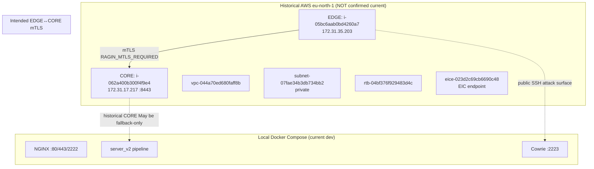
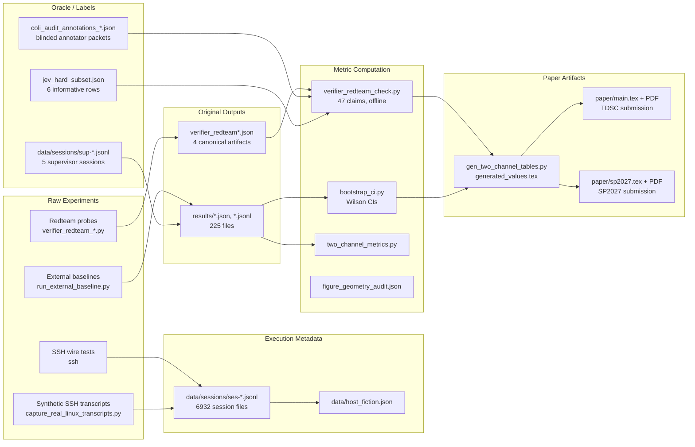

# 02 — RAGIN Architecture Map

**Source:** Source-grounded reconstruction from actual files. Graphify out/ exists (11M graph.json, 2026-09-27) but not re-queried for this pass.

## 2.1 High-level system architecture

```mermaid
graph TB
    subgraph Attacker_Layer ["Attacker Layer"]
        SSH[Cowrie SSH Honeypot<br/>Port 2223 / 22]
        HTTP_NGINX[NGINX Reverse Proxy<br/>Port 80/443/2222]
    end

    subgraph Field_Arm ["Field Arm (Docker Compose)"]
        COWRIE[Cowrie Container<br/>ssh://0.0.0.0:2223]
        CHROLLO[Chrollo Service<br/>python -m ragin.server --component chrollo<br/>:8081]
        DON[Don Service<br/>python -m ragin.server --component don<br/>:8082]
        HISOKA[Hisoka Service<br/>python -m ragin.server --component hisoka<br/>:8083]
        JEV[Jev Service<br/>python -m ragin.server --component jev<br/>:8084]
        GATEWAY[LLM Gateway<br/>Rust / OpenAI-compatible :8080]
        REDIS[Redis :6379]
        NGINX[NGINX :80/443]
        PROMETHEUS[Prometheus :9090]
        GRAFANA[Grafana :3000]
    end

    subgraph Pipeline_Server ["server_v2 Pipeline (auth authoritative)"]
        SV2[server_v2.py<br/>mode=pipeline<br/>Harness + Session + Sandbox]
        CHROLLO_ADP[ChrolloAdapter]
        DON_ADP[DonAdapter]
        HISOKA_ADP[HisokaAdapter / ProviderTransportAdapter]
        VERIFIER[FictionConsistencyVerifier<br/>+ HostFictionVerifier]
        HITL[ApprovalGateway<br/>risk-based policy]
        HOST_FIC[HostFictionStore<br/>data/host_fiction.json]
    end

    subgraph LLM_Backend ["LLM Backend (provider-specific)"]
        OPENCODE[OpenCode CLI Bridge<br/>loopback :8731/v1<br/>space-bunny-free]
        OR_AZURE[OpenRouter / Azure AI Foundry<br/>(when configured)]
        PROVIDER[ProviderTransport<br/>(when RAGIN_PROVIDER_ENABLED)]
    end

    SSH -->|SSH session| COWRIE
    COWRIE -->|POST /v1/chat/completions| SV2
    HTTP_NGINX -->|X-API-Key auth| CHROLLO
    HTTP_NGINX -->|X-API-Key auth| DON
    HTTP_NGINX -->|410 disabled| HISOKA
    CHROLLO -->|RAGIN_LLM_BASE_URL| GATEWAY
    DON -->|GATEWAY_URL| GATEWAY
    HISOKA -->|GATEWAY_URL| GATEWAY
    JEV -->|opencode.ai/zen/v1| OPENCODE
    GATEWAY -->|upstream| OPENCODE
    GATEWAY -->|upstream| OR_AZURE

    SV2 --> CHROLLO_ADP
    SV2 --> DON_ADP
    SV2 --> HISOKA_ADP
    SV2 --> VERIFIER
    SV2 --> HITL
    SV2 --> HOST_FIC
    CHROLLO_ADP --> CHROLLO
    DON_ADP --> DON
    HISOKA_ADP --> HISOKA
    HISOKA_ADP -->|optional| PROVIDER
    PROVIDER --> GATEWAY
```

## 2.2 Authoritative runtime call graph (server_v2 pipeline mode)

```mermaid
sequenceDiagram
    participant C as Cowrie/SSH attacker
    participant B as server_v2 openai_chat_completions
    participant S as Sandbox.handle_command
    participant H as Harness._process_verified
    participant SE as Session.emit (JSONL)
    participant CA as ChrolloAdapter.classify
    participant CDA as DonAdapter.analyze
    participant HD as HisokaAdapter.generate_response
    participant DE as AdaptiveDeceiver
    participant RG as ResponseGenerator
    participant GC as GatewayClient
    participant V as FictionConsistencyVerifier.verify
    participant HF as HostFictionVerifier.verify
    participant A as ApprovalGateway.resolve
    participant F as _strict_commit (fiction graph + host fiction)

    C->>B: POST /v1/chat/completions<br/>{messages: [{role:user, content:whoami}]}
    B->>B: Parse command from messages<br/>(or "The command to execute is:" in system)
    B->>B: Resolve session (X-Session-Id or transcript prefix or fresh)
    B->>S: handle_command(source_ip, command, session_id)
    S->>SE: Session.create or Session.wake<br/>(append-only JSONL)
    S->>H: harness.process(session, command)
    H->>SE: emit(ATTACKER_INPUT)
    H->>H: _build_and_store_context (replay log)
    H->>CA: classify(attacker_input, context)
    CA->>CA: Build SessionLog from context
    CA->>CA: RF model.predict (sklearn joblib)
    CA-->>H: {skill_level, confidence, features}
    H->>SE: emit(CLASSIFICATION)
    H->>CDA: analyze(attacker_input, context)
    CDA->>CDA: Build AnalysisRequest + session_log
    CDA->>CDA: ThreatRAGEngine.analyze
    CDA->>CDA: hybrid_search (BM25 + vector) → context → (optional LLM report)
    CDA-->>H: {severity, classification, tactics, iocs, threat_actors}
    H->>SE: emit(CTI_LOOKUP)
    H->>H: fiction(session_id, skill_level)<br/>→ FictionGraph or HostFictionStore.session_graph
    loop attempt 1..max_retries+1
        H->>HD: generate_response(attacker_input, enriched_context)
        HD->>DE: AdaptiveDeceiver.generate_response
        DE->>DE: persona selection + scenario identity<br/>+ authorization policy + canary arm
        DE->>DE: deterministic fast-paths<br/>(sudo, IMDS, SSH, sudo -l, credential bait, FS replay)
        DE->>RG: _gateway.generate(messages, model, temperature, max_tokens)
        RG->>GC: GatewayClient.generate (HTTP POST /v1/chat/completions)
        GC->>GC: auth headers, WAF path rewrite, reasoning_effort=low, retry
        GC-->>RG: (content, usage)
        RG-->>DE: response_text
        DE-->>HD: DeceptionResponse
        HD-->>H: dict(response_text, persona_used, artifacts, engagement, honeytoken_triggered, metadata, serve_path)
        H->>V: verify(candidate, verification_context)
        V->>V: _check_degenerate
        V->>V: _check_danger_signals (refusal/self-reference/secret patterns)
        V->>V: _check_identity_pin (whoami/id/hostname against pinned identity)
        V->>V: _check_fiction_contradictions (FictionGraph.observe)
        V->>HF: (if passed) HostFictionVerifier cross-session check
        HF->>HF: probe FictionGraph.observe → store.check_against_host
        V-->>H: {passed, issues, confidence, deterministic, serve_path}
        alt passed is True
            H->>A: approval_gateway.resolve(state with candidate)
            A->>A: risk_from_state → DefaultRiskBasedPolicy.level_for<br/>→ AUTO / NOTIFY / REQUIRE
            A-->>H: {approved, level, reason}
            alt approved is True
                H->>F: _strict_commit(candidate, verification, approval)
                F->>F: staged = graph.clone(); observed = staged.observe(text)
                F->>F: if contradictions → rollback
                F->>F: bridge_verifier_artifact (whoami/id/-un → canonical prompt template)
                F->>F: host_store.mark_verified + promote_verified + save
                F->>SE: emit(VERIFICATION)
                F->>SE: emit(SYSTEM_RESPONSE)
                F-->>H: True
                H-->>S: PipelineResult (response_text, events_emitted)
                S-->>B: SandboxResponse (response_text, command_count, event_count)
                B-->>C: HTTP 200 {choices: [{message: {content: response_text}}]}<br/>headers: X-Session-Id, X-Session-Token
                Note right of B: Field export: JSONL to RAGIN_FIELD_EXPORT_DIR
            else approved is False
                H->>H: verification.passed = False<br/>issues += [approval_not_granted]
            end
        else passed is False
            H->>H: feedback = "Previous response failed verification: ..."
        end
    end
    Note over H: Fallback: ResponseGenerator._generate_template<br/>(deterministic identity-bound template)
    H->>V: verify(fallback_candidate)
    alt fallback passes
        H->>A: approval
        alt approved
            H->>F: _strict_commit(fallback, FALLBACK_VERIFIED)
            F-->>S: PipelineResult with fallback text
        else
            H->>H: error = "verified_serve_unavailable"
            H-->>S: empty response + error
        end
    else
        H->>H: error = "verified_serve_unavailable"
        H-->>S: empty response + error
    end
    S-->>B: SandboxResponse (possibly empty + error)
    B-->>C: HTTP 503 {error: "verified_serve_unavailable"}<br/>(fail SAFE — never unverified content)
```

## 2.3 SSH request-to-response sequence (field arm C — Cowrie bridge)

```mermaid
graph LR
    A[Attacker SSH] -->|TCP :2223| COWRIE
    COWRIE -->|SSH session + command| COWRIE_INT[Cowrie internal<br/>TTY/JSON session log]
    COWRIE_INT -->|POST /v1/chat/completions<br/>messages=[{system, user, ...}]| SV2
    SV2 -->|X-Session-Id header| SV2
    SV2 -->|POST /api/session/command| SV2
    SV2 -->|Harness pipeline| SV2
    SV2 -->|session management| SV2
    SV2 -->|field export JSONL| FIELD[data/field/ragin/]
    SV2 -->|HTTP 200/503| COWRIE
    COWRIE -->|SSH stdout| A
```

Key detail: Cowrie's LLM backend POSTs the FULL conversation history each command. The bridge reconstructs session continuity by content-prefix matching (`_TRANSCRIPT_MAP`), not by session cookie. Each response sets `X-Session-Id` for future pinning.

## 2.4 Inference provider transport

```mermaid
graph TB
    subgraph "server_v2 _init_pipeline"
        PT_ENABLED{"RAGIN_PROVIDER_ENABLED=1?"}
        PT_ENABLED -->|YES| PTA[ProviderTransportAdapter]
        PT_ENABLED -->|NO| HA[HisokaAdapter]
    end

    subgraph "ProviderTransportAdapter"
        PTA -->|resolved_key present| PT[ProviderTransport<br/>GatewayClient subclass]
        PTA -->|no key| DEECEIVER[AdaptiveDeceiver<br/>(existing path)]
        PT -->|inject into| GEN[ResponseGenerator._gateway = PT]
        GEN --> DEECEIVER
    end

    subgraph "ProviderTransport"
        PT -->|generate()| GC[GatewayClient.generate<br/>HTTP POST /v1/chat/completions]
        PT -->|no key| PUE[ProviderUnavailableError]
    end

    PTA -->|generate_response()| DEECEIVER
    DEECEIVER -->|optional LLM draft| GEN
    GEN -->|when transport set| PT
    PT -->|HTTP| BACKEND[Provider backend<br/>(apmix / OpenRouter / Azure)]
```

**Configuration precedence for provider auth:**
1. `RAGIN_PROVIDER_API_KEY`
2. `RAGIN_HISOKA_API_KEY`
3. `RAGIN_LLM_API_KEY`
4. `OPENROUTER_API_KEY`
5. `OPENAI_API_KEY`
6. `AZURE_OPENAI_KEY`

**URL precedence:**
1. `RAGIN_PROVIDER_URL`
2. `RAGIN_HISOKA_GATEWAY_URL`
3. `GATEWAY_URL`
4. `http://localhost:8080`

**Placeholder detection:** Keys containing `your-`, `replace-me`, `<`, `$`, `changeme`, `placeholder`, `set-in-env`, `todo:`, or < 16 chars are treated as unconfigured.

## 2.5 Deterministic verification and commit flow

```mermaid
graph TD
    Candidate[Candidate response<br/>from Hisoka/Provider] --> V1[_check_degenerate<br/>len(strip) <= 1?]
    V1 -->|fail| REJECT[REJECTED<br/>response_text = ""]
    V1 -->|pass| V2[_check_danger_signals<br/>refusal/self-reference/secret patterns]
    V2 -->|fail| REJECT
    V2 -->|pass| V3[_check_identity_pin<br/>whoami/id/hostname vs pinned identity]
    V3 -->|fail| REJECT
    V3 -->|pass| V4[_check_fiction_contradictions<br/>FictionGraph.observe → contradictions]
    V4 -->|fail| REJECT
    V4 -->|pass| V5{HostFictionVerifier?}
    V5 -->|yes| V5A[probe.observe → store.check_against_host]
    V5A -->|contradiction| REJECT
    V5A -->|consistent| V6[PASS]
    V5 -->|no| V6
    V6 --> A[ApprovalGateway.resolve<br/>risk_from_state → policy]
    A -->|REQUIRE + no approver| REJECT
    A -->|approved| COMMIT[_strict_commit]
    COMMIT --> C1[staged = graph.clone<br/>observed = staged.observe(text)]
    C1 -->|contradictions| ROLLBACK[ROLLBACK<br/>graph restored, host fiction restored]
    C1 -->|clean| C2[bridge_verifier_artifact<br/>whoami/id/-un → canonical template]
    C2 --> C3[host_store.mark_verified<br/>host_store.promote_verified<br/>host_store.save]
    C3 --> C4[emit VERIFICATION<br/>emit SYSTEM_RESPONSE<br/>return True]
    ROLLBACK --> RETRY[Retry with feedback<br/>or fallback template]
    REJECT --> RETRY
    RETRY -->|exhausted| FALLBACK[Fallback: _generate_template<br/>verify → approve → commit<br/>or verified_serve_unavailable]
```

## 2.6 Fiction Graph and Host Fiction state

```mermaid
classDiagram
    class FictionGraph {
        +session_id
        +identity dict
        -_facts (subject,predicate)→(value,source)
        -_mentions
        -_contradictions
        +declare(subject, predicate, value, source)
        +observe(text, source) → ObservationResult
        +fact_block(cap) → str
        +clone() → FictionGraph
        +replace_from(other)
        +facts() → list
        +contradictions() → list
        +summary() → dict
    }

    class ObservationResult {
        +added list
        +contradictions list
        +mentions list
        +consistent bool
    }

    class HostFictionStore {
        +host_key
        +policy reconnect|per_session
        -_shared_graph FictionGraph
        -_host_facts (subj,pred)→{value:[session_ids]}
        -_sessions dict
        -_host_identity dict
        +session_graph(session_id, identity) → FictionGraph
        +mark_verified(session_id)
        +promote_verified(session_id) → int
        +check_against_host(session_id, graph) → CrossSessionCheck
        +save(path)
        +load(path) → HostFictionStore
        +to_dict() → dict
        +restore_from_dict(data)
        +pinned_identity → dict
    }

    class HostFictionVerifier {
        -_inner FictionConsistencyVerifier
        -_store HostFictionStore
        +verify(response, ctx) → dict
    }

    class CrossSessionCheck {
        +contradictions list
        +promoted list
        +checked_against int
        +consistent bool
    }

    FictionGraph "1" *-- "0..1" HostFictionStore : per-session graph (per_session policy)
    HostFictionVerifier --> FictionConsistencyVerifier : wraps
    HostFictionVerifier --> HostFictionStore : cross-session checks
```

**Identity seeds per skill level (ragin/hisoka/deception.py:44-91):**

| Skill | Host | Domain | IP | UID/GID |
|-------|------|--------|----|---------|
| novice | web-srv-01 | corp.local | 10.0.0.12 | 1001/1001 |
| intermediate | app-db-02 | corp.local | 10.0.2.51 | 1001/1001 |
| expert | core-lnx-03 | corp.local | 10.0.4.7 | 1001/1001 |
| advanced | app-corp-01 | corp.local | 10.0.6.90 | 1001/1001 |
| apt | sec-node-zen-02 | corp.local | 10.0.9.14 | 1001/1001 |

**Critical design point:** All personas share `user=webapp`, `uid=1001`, `gid=1001`, `distro=Ubuntu 22.04.3 LTS`, `kernel=5.15.0-91-generic`. They differ only in host/ip/domain/prompt/role. The HostFictionStore pins the host identity at FIRST contact so a returning attacker whose classification changes still faces the same box (test_host_fiction.py: TestHostIdentityPin).

## 2.7 AWS distributed deployment (intended vs actual)



**Status:** All AWS identifiers are HISTORICAL. No AWS read access confirmed in this audit. The `data/host_fiction.json` exists locally (34KB, untracked) which suggests local-only host fiction state. No current AWS instance state verified.

## 2.8 Research evaluation and artifact-generation pipeline



**Critical provenance gap:** The `verifier_integrity_provenance.json` records the git commit (f0c4042) and dirty state at generation time, but the individual result JSON files do NOT embed their own provenance. Lineage from raw experiment → metric → paper table is documented in scripts but not machine-checkable end-to-end for all artifacts.

## 2.9 Component relationship matrix

| Component | Depends on | Used by | Tested | Deployment |
|-----------|-----------|---------|--------|------------|
| server_v2.py | Harness, Sandbox, Session, adapters, HostFictionStore, mtls | Cowrie bridge, API callers | test_server_v2 (24 PASS), test_task2_verified_serving (13 PASS) | Pipeline mode default; standalone disabled |
| server.py | Chrollo, Don, Hisoka, Jev (standalone) | Legacy API callers | UNTESTED (legacy) | Legacy — hisoka returns 410 |
| Harness | Classifier, CTIEngine, Deceiver, Verifier, HITL, FictionGraph, HostFictionStore | Sandbox, server_v2 | test_cycle, test_task2 (230+13 PASS) | Core orchestration |
| Sandbox | Harness, Session | server_v2 | test_task2 (serialized concurrent test) | Attacker I/O isolation |
| Session | (file system JSONL) | Harness, Sandbox | test_cycle | Crash-safe event log |
| FictionConsistencyVerifier | FictionGraph, supported_claims (optional) | Harness, HostFictionVerifier | test_verifier (186 PASS) | Mandatory when m_verification=True |
| HostFictionVerifier | FictionConsistencyVerifier, HostFictionStore | Harness (when mandatory) | test_host_fiction (30 PASS) | Cross-session consistency |
| HostFictionStore | FictionGraph | Harness, server_v2 | test_host_fiction_wiring + test_host_fiction | Persisted to data/host_fiction.json |
| ChrolloAdapter | ChrolloClassifier (sklearn RF) | Harness | test_chrollo | Classification |
| DonAdapter | ThreatRAGEngine (BM25+vector+LLM) | Harness | test_don | CTI enrichment |
| HisokaAdapter | AdaptiveDeceiver, ResponseGenerator, GatewayClient | Harness | test_hisoka (100+ PASS) | Deception generation |
| ProviderTransportAdapter | ProviderTransport, AdaptiveDeceiver, ResponseGenerator | server_v2 (when enabled) | test_provider_transport (11 PASS) | Optional authenticated transport |
| ProviderTransport | GatewayClient | ProviderTransportAdapter | test_provider_transport | Fails closed when unauthenticated |
| GatewayClient | requests (HTTP) | ThreatRAGEngine, ResponseGenerator, ProviderTransport | UNITTED (via don/hisoka tests) | LLM backend transport |
| ResponseGenerator | GatewayClient, persona, identity, authorization policy, canary, FS ledger | AdaptiveDeceiver | test_hisoka | Core deception LLM + deterministic fast-paths |
| FictionGraph | (none — dependency-free) | FictionConsistencyVerifier, HostFictionStore | test_fiction_graph (part of 186) | Session-scoped fact graph |
| ApprovalGateway | DefaultRiskBasedPolicy, Approver, Auditor | Harness, HITL | test_hitl | HITL approval gate |
| ChrolloClassifier | sklearn RandomForest, joblib model | ChrolloAdapter | test_chrollo | Skill classification |
| ThreatRAGEngine | GatewayClient, VectorStore, BM25, ThreatMapper | DonAdapter | test_don | CTI analysis |
