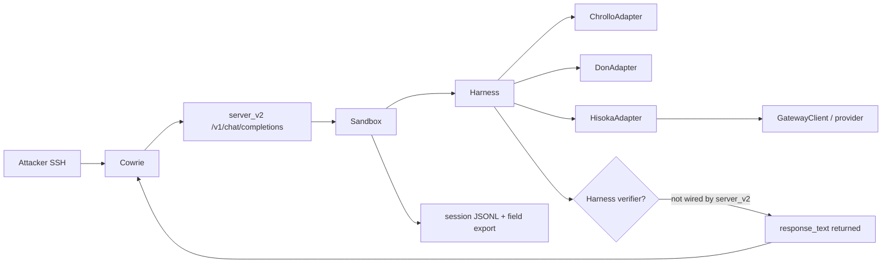
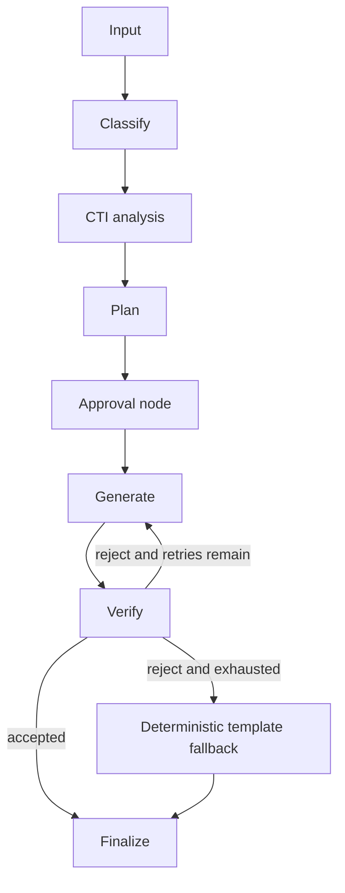

# RAGIN Task 1: Current Architecture and Serving Trace

## Task 2 correction (2026-10-08)

The implementation described by the original Task 1 baseline has been repaired at the application boundary. The authoritative field path is now `server_v2 --mode pipeline` -> `Sandbox` -> mandatory `Harness` verification. `server_v2._init_pipeline` constructs the Harness with `mandatory_verification=True`, a `HostFictionStore`, and a persistence path (`ragin/server_v2.py:603-633`). The strict Harness path rejects missing, malformed, false, or exception-raising verifier decisions; retries only within its configured bound; verifies the deterministic fallback; requires the configured HITL decision; and commits fiction/host state before emitting an accepted system response (`ragin/cycle/harness.py:222-406`).

The original trace below is retained as historical Task 1 evidence. It is not a current-runtime description after the Task 2 changes. The legacy generative routes now return HTTP 410, standalone `server_v2` mode is disabled, and metrics are no longer public exceptions to authentication (`ragin/server.py:249-282,719-727`; `ragin/server_v2.py:126-157,668-697`). AWS isolation is still not demonstrated, and the Rust gateway remains internal-only without demonstrated request authentication.

This document describes what the repository actually wires today. It separates executable paths from intended architecture described in comments, papers, or runbooks.

## Active path map

The field Compose path is `cowrie-llm -> ragin-server -> server_v2 --mode pipeline`. `server_v2._init_pipeline` (`ragin/server_v2.py:554-578`) constructs Chrollo, Don, Hisoka, `Harness`, and `Sandbox`, but does not pass a verifier to `Harness`. Therefore the `X` gate is absent in the deployed field path.

## Legacy component path

`ragin/server.py` is the default Python container entry point (`Dockerfile.python`). Its `/api/deceive`, `/api/lure`, and OpenAI-compatible paths call `_handle_deception` (`server.py:122-171,605-680`). That function invokes the component generator, caches the generated response, emits an audit record, and returns it. It does not call `FictionConsistencyVerifier`, `HostFictionVerifier`, or the LangGraph verifier before serving.

The legacy server registers component routes at `server.py:693-717`. Public prefixes include `/api/lure`, `/api/deceive`, and `/v1/chat/completions` (`server.py:244-265`), so those paths bypass the API-key middleware. `API_KEY` is empty by default (`server.py:27`), and binding to `0.0.0.0` produces a warning rather than a startup failure (`server.py:746-765`).

## Field/server_v2 request trace

1. Cowrie sends an OpenAI-compatible request to `/v1/chat/completions`.
2. `server_v2` extracts the latest user command and selects a session from `X-Session-Id`, a process-local transcript-prefix map, or a fresh ID (`server_v2.py:65-95,270-390`). The prefix map is bounded to 20,000 entries and is cleared wholesale at the cap.
3. The request reaches `_sandbox.handle_command`. Exceptions or result errors return a generic `bash: input/output error` response (`server_v2.py:270-390`). This is a transport fail-safe, not a verifier-approved deception fallback.
4. `Sandbox.handle_command` finds/creates a `Session`, increments its command count, invokes `Harness.process`, emits metrics, and returns `result.response_text` (`ragin/cycle/sandbox.py:107-182`). It does not independently require `result.verification.passed`.
5. `Harness.process` emits attacker input, builds context, classifies with Chrollo, performs Don CTI lookup, generates with Hisoka, calls `_run_verification`, and emits a system-response event (`ragin/cycle/harness.py:515-538`).
6. `_run_verification` returns without action when `self._verifier` is `None` (`harness.py:287-315`). If a configured verifier raises, it records `passed=True` with an error, which is fail-open. Retry verification catches further exceptions and continues (`harness.py:617-668`).
7. `HisokaAdapter` maps native fallback metadata but the active Harness path does not guarantee a deterministic, verifier-approved fallback after generation/retry exhaustion (`ragin/cycle/adapters.py:261-326`; `harness.py:617-668`).
8. `server_v2` attempts a best-effort field export after the response. Export errors are swallowed/logged (`server_v2.py:393-408`).

## LangGraph path that is not active in server_v2

`ragin/cycle/graph.py:1-22,96-139,260-460` implements this intended graph. It defaults to a `FictionConsistencyVerifier`, can opt into host fiction, and has retry/fallback nodes. However, `generate_node` calls fiction `.observe()` before verification (`graph.py:260-320`), so state can be mutated before acceptance in that path. `finalize_node` promotes host facts only after passed verification (`graph.py:396-416`). The graph is not constructed by `server_v2._init_pipeline`.

## State and identity

- `Session.create` generates `ses-{uuid}` and writes `SESSION_START`, including raw `source_ip` (`ragin/cycle/session.py:133-147`). Events are appended and fsynced, but no file lock is used.
- Context is reconstructed from attacker inputs, system responses, classifications, TTPs, and artifacts (`session.py` context/replay methods).
- Host-fiction storage is an in-memory `HostFictionStore` with save/load helpers (`ragin/graph/host_fiction.py:152-333`); host identity is pinned on first contact. Server wiring to durable host-fiction storage is not demonstrated.
- `server_v2` replay/context endpoints are API-key protected only when a non-empty key is configured and do not implement tenant/session-owner authorization (`server_v2.py:108-125,227-263`). A guessed or leaked session ID can therefore expose session context to any holder of the shared key, or to anyone when the key is empty.

## HITL and approval behavior

`ApprovalGateway` supports AUTO, NOTIFY, and REQUIRE levels and a file audit trail (`ragin/cycle/hitl.py:1-147,275-325`). The LangGraph has an approval node, but `server_v2` uses `Harness`, not the graph, and no operator approval endpoint or blocking approver is wired into the active field path. The default gateway policy is AUTO.

## Retrieval, prompts, and trust boundaries

- Don constructs analysis from classification, observed techniques, command features, session log, and retrieved documents (`ragin/don/rag_engine.py` and `ragin/don/models.py`). The repository has an `_sanitize_for_llm` helper for selected intel-content injection patterns (`ragin/don/models.py:210-237`), but no single mandatory trust-labeling boundary for all retrieved/corpus text was found.
- Hisoka sanitizes some attacker-input patterns (`ragin/hisoka/deceiver.py:589-598`) and post-processes output (`deceiver.py:2030-2059`), but prompt context is assembled from attacker history, CTI, fiction, strategy, and current input (`deceiver.py:3011-3035`). Sanitization is not equivalent to provenance, isolation, or verifier acceptance.
- The verifier checks dangerous content, fiction contradictions, identity, and degenerate outputs (`ragin/cycle/verifier.py:1-51,202+`), but its fail-closed option defaults off in the verifier class and is not wired in `server_v2`.

## Failure and timeout behavior

`ragin/gateway/client.py:70-274` uses environment-first provider configuration, a default 20-second timeout, one retry for selected status/transport failures, and empty-string return after exhausted/invalid provider responses. JEV uses a separate default 30-second timeout, one retry, and 429 cooldown (`ragin/jev/client.py:1-211`). These provider controls do not enforce a serving-time verifier gate.

## Implemented versus intended

| Capability | Implemented somewhere | Active field serving path | Evidence status |
|---|---:|---:|---|
| Chrollo profiling | Yes | Yes | `ChrolloAdapter` |
| Don retrieval/CTI planning | Yes | Yes | `DonAdapter` |
| Hisoka generation | Yes | Yes | `HisokaAdapter` |
| Fiction graph | Yes | No, unless separate graph caller | `cycle/graph.py` not constructed by `server_v2` |
| Deterministic verifier | Yes | No mandatory gate | `Harness` verifier is optional and absent in `_init_pipeline` |
| Deterministic fallback | Yes in graph path | Not guaranteed in Harness path | `graph.py:322-394` versus `harness.py:617-668` |
| HITL approval | Yes in graph/HITL modules | No | no `server_v2` wiring |
| Cross-session host identity | In-memory implementation | Not proven persistent/active | `host_fiction.py` only |
| Audit/provenance | Session/audit/field exports exist | Best effort and incomplete | `session.py`, `server_v2.py:393-408` |

## Current architecture conclusion

The repository currently contains multiple research and service variants, not one verified serving contract. The path that can be reached from the field Compose file does not meet the claimed “verify before serve, then commit state” invariant. This is the central architecture baseline for Task 2.
