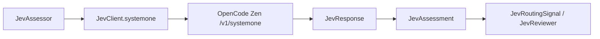

# JEV to Laya Migration Map

## Scope and non-goals

This is an integration-boundary audit and migration map only. Laya was not implemented, installed, contacted, or benchmarked. Historical JEV/OpenCode artifacts remain historical evidence and must not be relabeled as Laya results.

## Current JEV boundary



Concrete code locations:

- `ragin/jev/client.py:1-211`: HTTP client, default `https://opencode.ai/zen/v1`, default key `public`, default model `jev-1.13-free`, 30-second timeout, one retry, 429 cooldown, 8,000-character state cap.
- `ragin/jev/models.py`: `JevQuestion`, typed `NoulAnswer`/`ScoreAnswer`/`ChoiceAnswer`, `JevResponse`, `JevAssessment`, and serialization schema.
- `ragin/jev/assessment.py`: environment enablement (`RAGIN_JEVI_ENABLED`, default on), state construction, default questions, and failure-to-`None` behavior.
- `ragin/jev/orchestration.py`: additive risk mapping and reviewer. `JevReviewer.review` passes on JEV failure with low confidence, preserving base routing.
- `ragin/server.py:486-535`: `/api/assess` exposes assessment through the legacy server.
- `docker-compose.yml:141-173`: separate JEV service, published port, and direct OpenCode defaults.

The current JEV code is an optional/additive classifier/reviewer, not the generation/verifier boundary. No source/config reference to Laya or `RAGIN_LAYA` exists.

## Smallest safe replacement boundary

Replace the provider implementation behind a provider-neutral interface at the `JevAssessor`/`JevClient.systemone` seam, while keeping the typed decision contract initially stable:

```text
AssessmentProvider.assess(state, questions, deadline) -> TypedAssessment
```

The first safe migration should preserve:

- question types and bounded answers;
- `attack_probability`, `is_attack`, `severity`, and `attack_kind` semantics;
- explicit provider/model/version/provenance fields;
- additive routing semantics, where provider failure means “no additional signal,” not elevated risk;
- one bounded timeout and bounded retry policy;
- redacted state size limits;
- audit records that identify the provider and schema version.

Do not use Laya as an implicit replacement for Hisoka generation or the deterministic verifier. Laya can first replace only the optional JEV decision provider. A separate later decision is required if Laya is also used for generation.

## Proposed Laya adapter contract

| Concern | Current JEV | Required Laya adapter behavior |
|---|---|---|
| Transport | HTTP POST `/systemone` | Local/private HTTP or Unix-socket adapter, not attacker reachable |
| Auth | Bearer key, default public | Mandatory service identity; no public/default key |
| Model | `jev-1.13-free` | Explicit local model ID and model checksum/version |
| Input | bounded `state` plus typed questions | Same schema first; redact and label attacker-controlled fields |
| Output | typed answers and usage/model | Typed response plus Laya runtime/model provenance |
| Timeout | 30 s | Short, configured deadline aligned with CORE budget |
| Failure | `JevError`; assessment may return `None`; reviewer passes | Explicit `NO_SIGNAL` outcome, never an unverified serving decision |
| Retry | one retry; 429 cooldown | bounded retry only; no unbounded local queue |
| Historical comparison | OpenCode/JEV artifacts | New Laya artifacts in a new result namespace and manifest |

## Configuration migration

Retire from future execution after compatibility is proven:

- `RAGIN_JEVI_BASE_URL`
- `RAGIN_JEVI_API_KEY`
- `RAGIN_JEVI_MODEL`
- `RAGIN_JEVI_ENABLED` as an implicit-on default
- Compose `jev` service and direct OpenCode endpoint

Introduce a provider-neutral configuration with required non-secret endpoint/transport, model ID, schema version, timeout, and an explicit enablement flag. Secrets must come from a protected runtime secret mechanism. No values from `.env` or Compose defaults may be copied into this document or production deployment.

## Historical JEV evidence boundary

The following remain historical and provider-specific:

- `results/jev_ab_eval.json`: 200 held-out rows, but the recorded run had no available JEV assessments and therefore is not a JEV effectiveness result.
- `results/jev_hard_subset.json`: six informative rows, one assessed/rescued and five unavailable/refused; resolution-bounded.
- `results/jev_real_logs_eval.json`: 13 Cowrie sessions using a different historical `typesafe` endpoint and manually supplied severity labels; not evidence for a future Laya deployment.
- `scripts/jev_dwell_replay.py` outputs: simulated attacker/defender replay, not live attacker evidence.
- OpenCode author-fill/verifier red-team artifacts: historical research inputs, not JEV-serving or Laya-serving results.

These files must not be overwritten, regenerated in place, or renamed to imply Laya.

## Migration gates before implementation

1. Freeze the current JEV schema and identify all callers with tests.
2. Define Laya availability, authentication, timeout, and provenance contract.
3. Add contract tests using local fixtures only; no paid provider.
4. Prove provider failure produces `NO_SIGNAL` and cannot bypass CORE verification.
5. Run a new Laya-labelled benchmark with new input/result manifests.
6. Compare JEV and Laya only on a pre-registered, held-out, leakage-audited set.
7. Remove direct OpenCode/JEV deployment only after the new path is accepted and historical evidence is archived.

Task 2 must first choose whether Laya is an optional classifier/reviewer replacement or also a generation backend. The smallest safe choice is the former.
