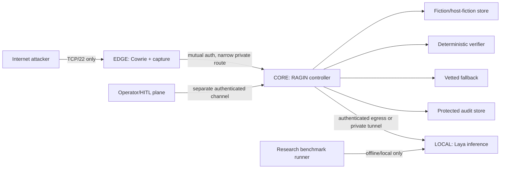
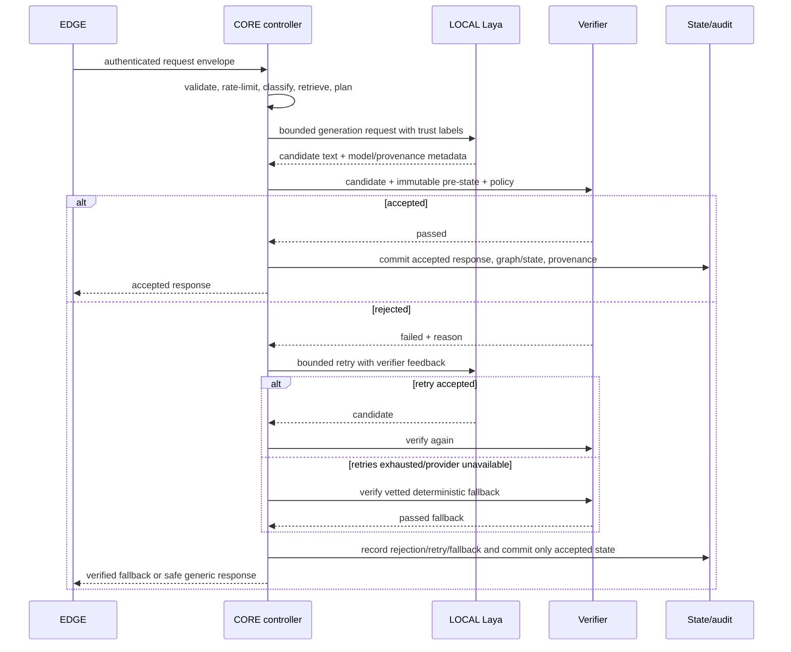

# RAGIN Task 1: Target EDGE / CORE / LOCAL Architecture

This is a security-oriented target baseline derived from the requested deployment intent. It is a design boundary, not a statement that the repository currently implements it.

## Application-layer realization after Task 2

The repository now realizes the application portion of the target contract through the repaired `server_v2` pipeline. Generated and deterministic fallback candidates are staged, deterministically verified, optionally approved, and committed before response delivery. Rejected drafts do not update fiction state. The legacy generator-facing routes are disabled rather than kept as a second weaker public path. This does not establish the EDGE/CORE private network, AWS security groups, service identity, metadata controls, or the Rust gateway's internal authentication; those remain deployment prerequisites.

## Required placement

### EDGE

The public instance must expose only the Cowrie SSH deception listener and narrowly scoped health/telemetry as required by operations. It must not expose the real host shell, Docker socket, RAGIN controller routes, session replay/context routes, provider keys, AWS metadata, or the local inference service. Cowrie must be configured as an emulator with explicit resource and command boundaries; the repository does not prove that this boundary is enforced by the current AWS deployment.

EDGE should forward a normalized, size-limited, rate-limited request envelope to CORE over a private route with service authentication. Raw attacker input is untrusted data, not an instruction to the control plane.

### CORE

CORE should have no public IP and reside in a private subnet/security group. It owns:

- session identity and authorization;
- Chrollo profiling;
- Don retrieval/planning with source and trust labels;
- Hisoka/Laya request orchestration;
- HITL policy and operator approval state;
- fiction and cross-session host state;
- deterministic verification;
- vetted deterministic fallback;
- append-only protected audit/provenance records.

The required serving sequence is:

No response may be served merely because generation returned text. No fiction, host identity, honeytoken, or cross-session fact may be promoted before the candidate or fallback passes verification. The current `cycle/graph.py` observes fiction before verification and therefore needs a transactional state boundary before it can be the target implementation.

### LOCAL

LOCAL hosts Laya and research benchmark tooling. It must not accept attacker traffic. The CORE-to-LOCAL interface should be one provider-neutral, authenticated, bounded adapter with explicit timeout, retry, model, and provenance fields. If a network tunnel is used, it must be initiated/authorized from the private side and must not bridge EDGE to the workstation. Laya outputs remain untrusted candidates until CORE verification.

## Network and IAM controls required before deployment

| Boundary | Required control | Evidence currently present |
|---|---|---|
| Internet -> EDGE | SG/NACL allow TCP/22 only, rate limit, abuse controls | Field Compose/runbook describe a port; AWS enforcement absent |
| EDGE -> CORE | Private subnet route, SG source restriction, mTLS or short-lived service identity | Not implemented in repo |
| CORE -> LOCAL | Authenticated private tunnel or allowlisted egress; no inbound attacker route | Not implemented in repo |
| CORE -> data | Least-privilege IAM, encrypted volume, audit append identity | No AWS/IAM config found |
| CORE -> metadata | IMDSv2/hop restriction or equivalent, no metadata exposure from attacker-facing containers | Not documented as deployed |
| All services | Secret manager/role-based credentials; no `.env`/placeholder production keys | Compose defaults include empty/placeholder keys |
| Operator -> CORE | Separate admin network, MFA/SSH controls, approval audit | HITL code exists; deployment plane absent |
| Emergency response | Instance/service stop, revoke route/SG, rotate credentials, preserve audit evidence | No executable AWS shutdown/runbook gate found |

## Required data controls

- Store raw attacker data separately from prompts and state; attach source, tenant/session, timestamp, redaction status, and trust level.
- Enforce session ownership/tenant authorization before context, replay, counts, snippets, or ranking.
- Hash or minimize source IPs before export; never include raw addresses in off-host research bundles unless explicitly authorized.
- Make audit events tamper-evident and include request ID, model/provider, prompt/context references, verifier version/result, fallback reason, state version, and commit decision.
- Use bounded request/response sizes and per-session/global rate limits with kill switches.

## Target acceptance gates

The target is not ready for public exposure until all are demonstrated in a controlled test environment:

1. EDGE cannot reach real shell, CORE admin routes, provider credentials, metadata, or LOCAL listening sockets.
2. CORE rejects missing/invalid service authentication and does not run with empty/placeholder production secrets.
3. Every served text has a recorded verifier decision; verifier errors fail closed.
4. State/fiction promotion is transactional and occurs only after acceptance.
5. Provider timeout, refusal, and rate limiting deterministically reach a vetted verified fallback.
6. Replay/context endpoints enforce session authorization.
7. Emergency shutdown and secret rotation are tested without destroying audit evidence.
8. A clean-room benchmark rerun can identify exact source, input hashes, model/provider, scorer version, and result artifact.

## Gap statement

`docker-compose.field.yml` is the closest current artifact to an isolated field topology, but it is Docker-bridge configuration plus a host provisioning script, not proof of the requested AWS EDGE/CORE/LOCAL separation. The target architecture remains a future implementation and deployment task.
