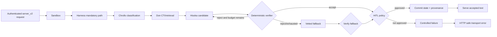

# Task 2: Serving-Path Decision

Status: application path selected and implemented; public deployment remains blocked by infrastructure prerequisites.

## Decision

Use the repaired Python `Harness` behind `Sandbox` as the single authoritative serving path:

The selection is grounded in the active field wiring: `docker-compose.field.yml` starts `ragin.server_v2 --mode pipeline`, and `_init_pipeline` now creates a mandatory-verification Harness and Sandbox (`ragin/server_v2.py:603-633`). `Sandbox.handle_command` is also the serialization boundary for concurrent attacker commands (`ragin/cycle/sandbox.py:109-116`).

## Harness versus LangGraph

Repairing Harness is the least risky operational choice because it is already the active field entry point, has the smallest adapter surface, and preserves existing Chrollo/Don/Hisoka interfaces and session event semantics. The strict path is explicit and easy to audit: `_process_verified`, `_strict_verify`, `_strict_commit`, and the bounded loop are in `ragin/cycle/harness.py:222-406`.

LangGraph remains useful for checkpointed research experiments, but it is not selected as a second deployable path. Its implementation has now been repaired to stage fiction observation and verify fallback candidates (`ragin/cycle/graph.py:321-425`), but it is not constructed by `server_v2`. It therefore remains non-public until it is separately proven equivalent on authentication, HITL, provenance, persistence failure, and HTTP behavior. This avoids two publicly reachable paths with different guarantees.

Legacy routes are not a fallback serving path: `ragin/server.py` returns 410 for its generative deception routes, and `server_v2` rejects standalone mode (`ragin/server.py:29,137-140,719-727`; `ragin/server_v2.py:697`).

## Non-goals and residual blockers

This decision does not claim AWS EDGE/CORE isolation, Rust gateway authentication, Laya integration, or provider availability. Laya remains an optional future assessment/generation provider boundary; it cannot replace the deterministic verifier or Hisoka in this task.
