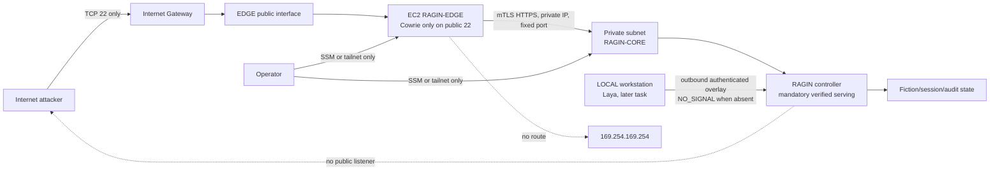

# RAGIN Task 3: Target AWS Network Architecture

## Design decision

Use one VPC in `eu-north-1` with a public EDGE subnet and a private CORE subnet. Do not add a NAT Gateway, load balancer, or new EC2 instance without separate approval. The cost-minimal design keeps CORE off the public Internet and uses an authenticated operator/service overlay for management and LOCAL-Laya connectivity. A managed SSM design is an alternative when its endpoint and logging cost is approved.

## Zones and allowed flows

| Zone | Placement | Allowed inbound | Allowed outbound | Explicitly forbidden |
|---|---|---|---|---|
| PUBLIC / EDGE | Public subnet, one public interface | TCP/22 from Internet to Cowrie container only; management only through operator overlay/SSM | CORE mTLS port; VPC resolver; tightly controlled update/telemetry path if approved | Ubuntu sshd on public interface, Docker socket, metadata, CORE admin ports, arbitrary C2 or Internet relay |
| PROTECTED / CORE | Private subnet, no public IPv4, no IGW route | EDGE SG to one authenticated controller port; operator overlay/SSM; no Internet source | LOCAL overlay and approved telemetry; no broad Internet egress by default | Public HTTP/HTTPS, public SSH, direct attacker access, unauthenticated Rust gateway, provider credentials on EDGE |
| LOCAL | Research workstation, not an AWS public service | No inbound attacker traffic; operator-controlled overlay only | Authenticated Laya service when enabled | Direct reachability from EDGE or attacker, verifier bypass, public inference endpoint |

The CORE route is private because the route table, interface, and absence of public IPv4 jointly enforce it. A restrictive security group on an instance that still has a public IP is not equivalent to a private subnet.

### Existing-CORE migration branch

Do not attempt to make an existing public instance private by changing only its security group, route table, or public DNS. An EC2 primary network interface is subnet-bound; a safe cross-subnet conversion normally requires a separately approved replacement or restore into the private subnet. The non-destructive sequence is:

1. Capture a redacted read-only inventory and verify the current administrative path; make no change to the existing CORE.
2. If it is not already private, obtain explicit approval for a temporary replacement/restore path, with budget and rollback owner. Use an approved image or encrypted volume snapshot; do not copy secrets into the repository.
3. Launch/configure the replacement without a public IPv4 address, establish operator access, mTLS, encrypted state, and protected audit delivery, and run the acceptance tests while the current CORE remains untouched.
4. Cut EDGE over to the replacement private address only after positive and negative tests pass. Preserve the old node for rollback and evidence; do not terminate or revoke its access in this task.
5. Retire or quarantine the old node only in a later, separately approved change window after the rollback period and evidence hold are satisfied.

If replacement approval is not granted, the existing CORE remains a deployment blocker; no in-place shortcut is acceptable.

## Observed gap from the target

The authorized SSH inspection found both nodes in the same VPC but in different subnets, each with a public IPv4 address. CORE is therefore not currently demonstrated to be private. EDGE currently exposes Ubuntu `sshd` on public TCP/22; Docker and Cowrie were absent. These are current-state observations, not target-architecture controls.

## Separation requirements

1. EDGE must send only the minimum request envelope to CORE over authenticated TLS. It must not carry provider keys, AWS role credentials, database credentials, or Docker control data.
2. CORE must expose one controller listener bound to its private interface. Bind the Rust gateway only to an internal loopback/private interface if it is retained for research; it is not part of the field dependency path until authenticated middleware exists.
3. Cowrie terminates the attacker protocol. The host SSH daemon must bind only to the management overlay or SSM path. No attacker-controlled command is passed to the Ubuntu shell.
4. State and audit storage remain on CORE, using encrypted storage and a protected append-only destination. EDGE stores only bounded session capture needed for forwarding and emergency evidence preservation.
5. LOCAL-Laya is an optional assessment provider in a later task. A disconnected LOCAL service yields `NO_SIGNAL` and never relaxes verification or fallback policy.

## Low-cost and alternative access models

| Model | Benefit | Cost/risk |
|---|---|---|
| Operator overlay (preferred cost-minimal baseline) | No public CORE address, no NAT Gateway, supports operator and LOCAL outbound-initiated connectivity | Requires hardened overlay ACLs, key rotation, and independent application mTLS; overlay is not itself application authorization |
| AWS Systems Manager | Removes public SSH and gives auditable operator sessions | Private CORE needs SSM reachability, commonly interface endpoints or approved egress; endpoints and logs may incur charges; must verify before locking out SSH |
| Bastion host | Familiar administration pattern | Adds an instance and cost; explicitly outside this task's no-new-EC2 constraint |

## Emergency isolation

The operator runbook must be able to revoke EDGE ingress/egress by replacing its SG with a quarantine SG, stop the Cowrie service, and preserve local evidence. The procedure must be tested with an operator session already open and must not depend on the compromised EDGE host. CORE remains running for audit retrieval unless its compromise is suspected.
