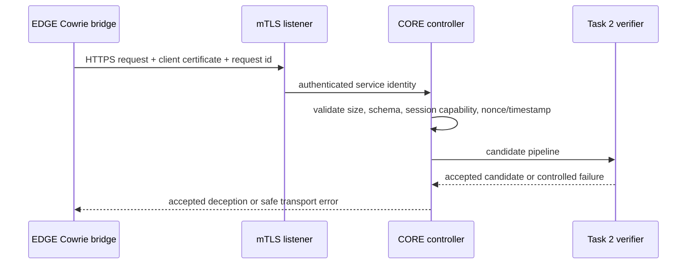

# RAGIN Task 3: CORE Service Authentication

## Decision

Use mutually authenticated TLS for the EDGE-to-CORE controller call, with application authorization and the Task 2 service credential as defense in depth. A Docker bridge, private subnet, or SG reference is not authentication. The Rust gateway is **excluded from the future field serving dependency path** until it has authenticated middleware, authorization tests, and a bounded failure contract.

## Protocol contract

## Required controls

| Control | Requirement |
|---|---|
| Service identity | One certificate per EDGE service instance or deployment identity; CORE has a distinct server certificate. Do not use one shared client certificate for all future endpoints. |
| Trust | Private CA pinned to the controller; validate SAN, issuer, expiry, revocation/rotation state, and TLS version. Do not disable verification for private IPs. |
| Authorization | CORE maps certificate identity to `edge-cowrie` and permits only the session-command operation. Context, replay, operator, and admin operations require separate scopes and session capability tokens. |
| Replay | Request ID plus timestamp/nonce; CORE rejects stale or repeated envelopes. Session IDs alone are not authorization. |
| Limits | Bounded JSON body, command length, transcript length, response size, concurrent sessions, timeout, and retry budget. Reject before model/provider work. |
| Rate limiting | Per service identity and per session; apply a global circuit breaker and emergency deny control. Rate limit failures are safe transport errors, not raw generated text. |
| Provenance | Forward a correlation ID and retain the mTLS identity, request digest, verifier decision, fallback transition, commit result, and served digest on CORE. |
| Secrets | Client private key is readable only by the Cowrie bridge service identity. Provider/model keys never appear on EDGE. Rotate certificates and application keys without simultaneous downtime. |

## Existing application relationship

Task 2 made `server_v2` require an application key and session capability for active APIs (`docs/task2/AUTHENTICATION_REMEDIATION.md`). The current field Compose injects `BACKEND_API_KEY` into Cowrie and CORE (`docker-compose.field.yml:76-79,126-128`). That is an interim shared bearer secret, not the final service identity. Keep it until mTLS is deployed and tested, then rotate it; never use a placeholder or empty value.

## Laya and provider failures

Laya is not implemented in Task 3. Later, it may be an optional authenticated LOCAL decision provider. Connection failure, timeout, missing provider, or `NO_SIGNAL` must remain an input to the verified contract, never an authorization to serve. Hisoka generation and the deterministic verifier remain separate responsibilities.

## Rust gateway disposition

`llm-gateway/src/main.rs:58-128` registers generation, model, cost, health, and metrics routes without visible authentication middleware. `llm-gateway/config.toml:126-129` has an empty `api_keys` map and wildcard CORS. The gateway is not a field dependency in this design. If it is reintroduced, it needs its own mTLS or equivalent service auth, per-route authorization, private bind, metrics protection, request limits, and offline regression tests before exposure.

