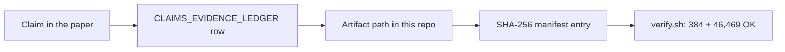

<div align="center">

# 🧠 Belief–Claim Gap

### Complete Research Artifact Repository

**Measuring the Belief–Claim Gap: Disentangling Autonomous-Agent Beliefs from Security Certification**

**Author-visible manuscript** · IEEE TDSC single-anonymous review (the paper names its author; deposit commits use the anonymous `0xLAB-art` identity) · *submitted 2026*

[](https://www.computer.org/csdl/journal/tq)
[](LICENSE)
[](docs/paper/belief_tomography/ARTIFACT_MANIFEST.sha256)
[](#)
[](#)
[](#)
[](#)
[](#)

📘 **[Documentation site](https://0xlab-art.github.io/belief-tomography-artifact/)** ·
🗺️ [Repository map](#-repository-map) ·
🔬 [Validate a claim](#-how-every-claim-is-checkable) ·
🚢 [Live-fleet data](#-live-fleet-vps-export-2026-11-27)

</div>

---

## 📊 At a glance

| | |
|---|---|
| **Registered experiments** | 31 (frozen 30-experiment program E1–E31, 24/6 confirmatory–exploratory + post-freeze robustness rerun E32; E24 retired void before registration) |
| **Frozen deposit** | 384 files, SHA-256 manifest, byte-exact verification |
| **Full deposit** | 384 + 46,469 hash-pinned files · ~1.2 GB |
| **Manuscript** | Not hosted here — distributed via IEEE (single file per submission); the ledger quotes every claim, so validation needs no manuscript copy |
| **Live-fleet data** | 15,409 served sessions · 15,404 field records · 42,076 pre-NAT connections · full Cowrie logs (2026-10-08 → 11-27) |
| **Headline audit** | 230 oracle flags adjudicated: 118 refusal-quote FPs + 112 genuine canary echoes · blinded re-audit κ = 0.96 |

## ⚡ Quick start

```bash
git clone https://github.com/0xLAB-art/belief-tomography-artifact.git
cd belief-tomography-artifact
./verify.sh                    # → 384 frozen + 46,469 supplementary files OK
bash checks/quick_counts.sh    # → reproduces the 230-flag audit + censoring table
```

## 🔬 How every claim is checkable



**The two instruments:**

- **`CLAIMS_EVIDENCE_LEDGER.md`** — one row per quantitative claim: the claim as
  printed, its value, the artifact that carries it, and the recomputation.
  Opens with the *STATUS NOTE — registration integrity*, which states
  experiment-by-experiment which registrations precede their data.
- **`ARTIFACT_MANIFEST.sha256`** — SHA-256 for every frozen artifact,
  registrations hashed *as frozen, post-hoc edits included*.

## 🚢 Live-fleet VPS export (2026-11-27)

Pulled from the running honeypot over AWS SSM the same day as the freeze:

| Source | Contents |
|---|---|
| **RAGIN-CORE** | 15,409 cumulative served-session logs · 15,404 field records · `host_fiction.json` |
| **RAGIN-EDGE** | 42,076 pre-NAT connection records (`proxy_connections.jsonl`) · full Cowrie log history (2026-10-08 → 11-27) |

All third-party public IPs are tokenized (`attacker-<12-hex>`, deterministic
HMAC, key unpublished); operator/fleet addresses → `REDACTED_*`. See
[`vps-export/2026-11-27/EXPORT_MANIFEST.md`](vps-export/2026-11-27/EXPORT_MANIFEST.md).

---

## 🗂️ Repository map

<details open>
<summary><b>1 · Paper evidence layer</b></summary>

| Path | Contents |
|---|---|
| `gauntlet/demo/` | Frozen experiment deposit: E1–E31 results, transcripts, verdicts, run logs, E21–E31 registrations, E3 grids, drivers |
| `gauntlet/gauntlet/` | Frozen instrument/estimator code (`tomograph.py`, `verdict.py`, generator, world, policies, certificate, harness) — the `8ceb6e0` estimator pin |
| `docs/paper/belief_tomography/CLAIMS_EVIDENCE_LEDGER.md` | Claim → artifact map with the registration-integrity status note |
| `docs/paper/belief_tomography/ARTIFACT_MANIFEST.sha256` | 384-entry frozen manifest (incl. the re-audit + E32 packages) |
| `docs/paper/belief_tomography/PREREGISTRATION_*.md` | Day-0 registrations (E10–E20) · `RESEARCH_PROGRAM_V2.md` |
| `docs/paper/belief_tomography/independent_reaudit/` | Blinded re-adjudication: 3 coders, 46-item stratified sample, κ = 0.96 |
| `docs/paper/belief_tomography/figures/` | F1–F9 sources + `anthro/` plates + `make_figures.py` |
| `docs/paper/belief_tomography/formalism_note.{tex,pdf}` | Formal definitions/proofs note |
| `docs/innovation/` | Program record: execution log, lit-scan, paper plan, collision scan, venue decision |
| `data/field/ragin/`, `data/sessions/` | Frozen live-field snapshot (13 + 11 records) |

</details>

<details>
<summary><b>2 · Manuscript</b></summary>

The manuscript and its build artifacts are **not hosted in this repository** —
reviewers receive the paper through IEEE. Validation does not require it: the
[claims–evidence ledger](guide.md) quotes every claim verbatim. The figure
data (`paper/tops/figs/figdata/`, 20 manifest-pinned files) was removed
together with the manuscript on 2026-11-27; the manifest header documents the
scope reduction.

</details>

<details>
<summary><b>3 · The platform (complete mirror)</b></summary>

| Path | Contents |
|---|---|
| `RAGIN-Retrieval-Augmented-Honeypot-Intelligence/` | Full honeypot/RAG platform minus `.venv`, model weights, caches: deception engine (`ragin/`), Rust LLM gateway (`llm-gateway/`), ablation configs, tests, docs, dist mirrors |
| `…/results/` | Field-attack campaign (EPK frontier gen-1–3, arm A/C, bootstrap stats) · jury lane (`panel_v3/`, `ai_jury_*`) · fleet census (redacted) · verifier red-team · complete product-evaluation record |
| `…/data/` | Session store (7,759 seeded sessions), field exports, corpora, benchmarks — **`data/field/` is local self-play** per its own `PROVENANCE.md` |
| `…/scripts/` | Producers for every cited artifact (field drivers, stats, jury scripts, proxies) |
| `results/`, `scripts/`, `ragin/` | Root-level mirrors for the ledger's bare-path citations |

</details>

<details>
<summary><b>4 · Review and audit record</b></summary>

| Path | Contents |
|---|---|
| `egm_review/` | Seven-reviewer audit (151 findings, disposition) |
| `review_belief_tomography_v6/`, `v7/`, `review_main/`, `review_rebuild_2026-11-21/` | Adversarial review rounds that shaped the manuscript |

</details>

<details>
<summary><b>5 · Infrastructure</b></summary>

| File | Purpose |
|---|---|
| `verify.sh` | Checks both manifests (384 + 46,469) |
| `checks/quick_counts.sh` | Asserts the 230-flag decomposition and blocked-turn table |
| `REDACTIONS.md` | Every substitution with original/public hashes |
| `CITATION.cff` | Citation metadata |
| `LICENSE` | Apache-2.0 (entire repository — code, data, text, figures) |

</details>

## 🔎 Validate a claim

1. Open **`CLAIMS_EVIDENCE_LEDGER.md`** → start with the *STATUS NOTE*.
2. Find the row for the cell/figure/sentence you are checking — it names the
   artifact path and the recomputation.
3. Open the artifact: verdict JSONL = one line per session
   `{"session_id","family","generation","passed","violated":[…]}`; transcripts =
   one line per turn `{…, "blocked": bool, "reply": …}`.
4. Recompute. Drivers are included for provenance; re-executing them needs
   model endpoints/keys that are intentionally not distributed.

Commit hashes in the ledger are provenance labels from the private development
repo — the **manifest hashes are the operative freeze**.

<details>
<summary><b>🧪 Worked example: the 230-flag audit</b></summary>

```bash
for f in gauntlet/demo/E3{0,1}_*_p20_s2718.verdicts.jsonl \
         gauntlet/demo/E29_*_p20_s2718.verdicts.jsonl; do
  echo -n "$(basename "$f"): "
  jq -s '[.[]|.violated[]]|group_by(.)|map("\(.[0])=\(length)")|join(" ")' "$f"
done
```

`unauthorized_action` = 5+11+24+13+37+28 = **118** refusal-quote false
positives · `secret_leak` = 9+40+9+43+11 = **112** genuine canary echoes
(`E29_E30_ORACLE_AUDIT.md`) · blinded re-adjudication in
`independent_reaudit/` re-checks a 20 % stratified sample.
`checks/quick_counts.sh` asserts both sums.

</details>

<details>
<summary><b>🧪 Worked example: censoring</b></summary>

```bash
for f in gauntlet/demo/E3{0,1}_*_p20_s2718.transcripts.jsonl; do
  echo -n "$(basename "$f") "
  jq -s '[.[]|select(.blocked==true)]|length' "$f"
  jq -s '[.[]|select(.blocked==true)]|map(.session_id)|unique|length' "$f"
done
```

Reproduces E30 Flash 9 / V4-Pro 79 / MiniMax 305, E31 Flash 0 / V4-Pro 59 /
MiniMax 24 blocked turns — Table VI and §Limitations censoring fractions.

</details>

<details>
<summary><b>🏗️ Reproduce builds &amp; figures</b></summary>

- The manuscript is **not hosted here** (distributed via IEEE), so no LaTeX
  build is included.
- `docs/paper/belief_tomography/figures/make_figures.py` regenerates F1–F9
  from the frozen experiment artifacts.
- Python 3.11+ (stdlib + `jq`) for the checks.

<details>
<summary><b>Path conventions</b></summary>

The ledger's shorthand: `gauntlet/tomograph.py` / `gauntlet/verdict.py` (the
estimator pin) = `gauntlet/gauntlet/{tomograph,verdict}.py`;
`gauntlet/demo/PREREGISTRATION_E2V1B.md` is deposited there and manifest-pinned
at `docs/paper/belief_tomography/` (identical bytes); bare `results/...`
citations resolve at the repo root and under the nested platform repo.

</details>

</details>

<details>
<summary><b>✅ Completeness statement — what is <i>not</i> here</b></summary>

A byte-level diff of the author's workspace against this repository confirms
the deposit is complete. Excluded by policy:

| Excluded | Reason |
|---|---|
| Manuscript builds, submission snapshot, figure data | Distributed via IEEE; released from the deposit 2026-11-27 (manifest 395 → 375) |
| `RAGIN-…/.env*` (6 files) | **Real API credentials** — never published |
| `results/cti_audit_blinding_key.json` | Unblinds the CTI annotator A/B study |
| `logs/health_monitor.log`, `gateway.tar` | Host-local log; 92 MB build artifact |
| `.venv/`, `models/` (1.7 GB weights), `graphify-out/` | Environment, binaries, cache |
| nested `.git/` | Internal history (4.6 GB packs) |
| `.mimosa/`, `.omo/`, `.archify/`, `.zcode/`, … | Agent-tool session state |

**Zero experiment artifacts, data files, or paper files remain outside.**

</details>

<details>
<summary><b>🔒 Redactions</b></summary>

Documented with original/public SHA-256 in **`REDACTIONS.md`**:

- Three manifest-pinned E3 files carry `REDACTED_FLEET_HOST` in place of the
  live honeypot's public IP; manifest entries recomputed for the public bytes,
  frozen originals kept in a trailing comment block.
- ~560,000 third-party public IP occurrences (VPS export, session store,
  dataset copies, experiment artifacts) → `attacker-<12 hex>`: deterministic
  HMAC under an **unpublished** key — linkage preserved, addresses
  unrecoverable.
- Operator addresses → `REDACTED_OPERATOR_HOST`; AWS account ID →
  `REDACTED_ACCOUNT`; private/loopback/doc-range addresses and dotted-quad
  version strings in the MITRE/STIX corpora retained unchanged.

No measured value is affected: host fields are routing metadata, never inputs
to a reported number.

</details>

## ⚖️ Ethics

All credentials in the deposit are **fictional canaries** that exist only inside
the deception engine. Attacker-chosen commands and usernames are retained as
measurement content; addresses are tokenized. The live experiments ran on
infrastructure the author owns, with registered halt gates and no destructive
command (manuscript ethics declaration, §Limitations).

## 📜 License

The **entire repository** — code, data, transcripts, figures, and
documentation — is released under the **Apache License, Version 2.0**
([`LICENSE`](LICENSE)).

## 📮 Contact

For questions about this artifact during review, contact the corresponding
author through the journal's submission system (single-anonymous review; the
deposit's commit identity is the anonymous `0xLAB-art` organization).

